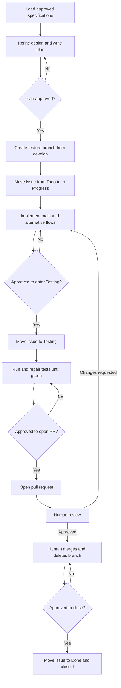

# Development Workflow Document — Chimera

## 1. Purpose

This document defines how a use case moves from backlog to merged: refinement,
branch creation, issue status, implementation, testing, pull request, review, and
closure. It formalizes the approved
[Workflow](../initial/Workflow.md) without changing its stages or gates.

> **One use case = one branch = one issue = one pull request.**

The foundation issue is the sole non-use-case exception; it still uses one branch,
one issue, and one pull request.

---

## 2. Workflow at a Glance



The only unattended status transition is **Todo → In Progress**, immediately
after branch creation. Every other stage boundary requires explicit approval.

---

## 3. Issue Status Lifecycle

| Order | Status | Set when | Approval |
| --- | --- | --- | --- |
| 1 | **Todo** | The use case has not started. | Existing backlog state. |
| 2 | **In Progress** | Its branch exists and implementation begins. | May be set unattended after plan approval. |
| 3 | **Testing** | Implementation is code-complete and the test gate begins. | Explicit approval required. |
| 4 | **Done** | Human review, merge, and branch deletion are complete. | Explicit approval required before closing. |

Review changes stay on the same issue and branch. When code changes after a test
run, the affected suites run again before review continues.

---

## 4. Step-by-Step Process

### Step 1 — Load the Specifications

The implementer reads the target use case and every traced requirement from:

- [Use Case Specification Document](Use%20Case%20Specification%20Document.md)
- [System Requirements Document](System%20Requirements%20Document.md)
- [Technology Stack Document](Technology%20Stack%20Document.md)
- [Testing Specification Document](Testing%20Specification%20Document.md)
- [Operations & Infrastructure Document](Operations%20%26%20Infrastructure%20Document.md)

The implementer also locates the corresponding GitHub issue. If the identifier is
missing, ambiguous, or inconsistent with the documents, work stops for correction.

### Step 2 — Refine the Design and Plan

The implementer maps the specification to repository components, interfaces,
validation, result types, localization, and tests. The written plan covers the
main flow and every applicable alternative flow and orders implementation
test-first.

The design and plan are presented for approval. No product code is written before
that approval.

### Step 3 — Create the Branch

After plan approval, create a branch from an up-to-date `develop` branch using
`feature/uc-##-short-name`:

```bash
git switch develop
git pull
git switch -c feature/uc-03-convert-json-array-to-table
```

Move the GitHub issue from **Todo** to **In Progress**. This is the one status
transition that does not require another approval.

### Step 4 — Implement

Implement the approved plan using the architecture and dependency policy in the
Technology Stack Document. The shared utility package owns behavior; GUI and CLI
code adapt that behavior rather than duplicate it. Main and alternative flows,
localized diagnostics, and tests evolve in the same branch.

### Step 5 — Request Approval for Testing

When implementation is code-complete, stop and summarize what was built. Only
after explicit approval may the issue move to **Testing**.

### Step 6 — Test Until Green

Follow the Testing Specification. The baseline project command remains:

```bash
flutter test
```

Run all additional target-specific suites required by the change. Fix failures
and rerun affected and full suites until everything passes. Present the evidence
and stop for approval before opening a pull request.

### Step 7 — Open the Pull Request

After approval, push the branch and open a pull request into `develop`. The
Yggdrasil branch-policy check and all catalog-required GitHub Actions checks must
pass. The pull request body:

- identifies the use case and traced requirements;
- summarizes the implementation and test evidence;
- calls out operational or compatibility impacts; and
- includes `Closes #<issue-number>`.

### Step 8 — Human Review and Merge

A human reviews and merges the pull request and deletes the branch. An agent may
prepare and push the pull request but shall not approve it, merge it, or delete
the branch. Requested changes return to implementation and testing on the same
branch.

### Step 9 — Close the Issue

After human merge and branch deletion, stop for explicit approval. Then move the
issue to **Done**, close it, and confirm the final state.

Merging a use-case pull request completes that unit of work on `develop`; it does
not publish a production release. Release promotion is the separate UC-46 flow in
the
[Operations & Infrastructure Document](Operations%20%26%20Infrastructure%20Document.md):
an approved `release/x.y.z` snapshot of `develop` is promoted to `main` through
Yggdrasil.

---

## 5. Definition of Done

- [ ] The approved design and plan cover the use case and every traced requirement.
- [ ] Work is on a `feature/uc-##-short-name` branch created from current `develop`.
- [ ] The main flow and every applicable alternative flow are implemented.
- [ ] Shared behavior is implemented once and consumed by affected interfaces.
- [ ] English and Brazilian Portuguese behavior is complete where user-facing text changes.
- [ ] Tests meet the Testing Specification on every affected supported target.
- [ ] The full relevant suite is green.
- [ ] A human reviewed and merged the pull request.
- [ ] The branch was deleted.
- [ ] Explicit approval was given to move the GitHub issue to **Done** and close it.

---

## 6. References

- [Use Case Specification Document](Use%20Case%20Specification%20Document.md) — use case definitions and flows.
- [System Requirements Document](System%20Requirements%20Document.md) — functional and non-functional requirements.
- [Testing Specification Document](Testing%20Specification%20Document.md) — test structure and execution.
- [Technology Stack Document](Technology%20Stack%20Document.md) — technologies and version policy.
- [Operations & Infrastructure Document](Operations%20%26%20Infrastructure%20Document.md) — repository and delivery requirements.
