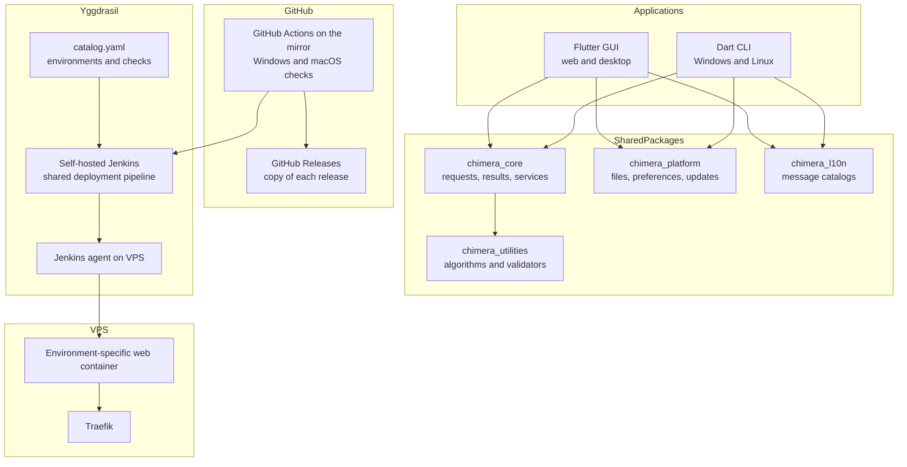

# Operations & Infrastructure Document — Chimera

## 1. Introduction

### 1.1 Purpose

This document captures Chimera's repository, configuration, observability,
health, environment, build, packaging, release, and deployment requirements. The
specific tools and version policy are defined in the
[Technology Stack Document](Technology%20Stack%20Document.md).

### 1.2 Scope

- Monorepo and shared-module structure.
- Local and deployment configuration.
- Privacy-preserving diagnostics and operational monitoring.
- Container liveness.
- Local, development, homologation, and production environments as resolved by
  the Yggdrasil catalog.
- Yggdrasil's Jenkins checks, the GitHub Actions jobs on the GitHub mirror,
  native packaging, Yggdrasil release promotion, and web deployment.
- The operational use case for publishing a release.

---

## 2. Technical Foundation

### 2.1 Overview

Chimera is a monorepo containing one Flutter GUI application, one Dart CLI, and
shared Dart packages for domain-independent application services, utility
algorithms, localization, and platform adapters. The foundation establishes the
dependency direction, test harnesses, delivery workflows, and Docker web runtime
on which every use-case branch builds.

### 2.2 Solution Architecture



### 2.3 Repository Layout

```text
apps/
├── chimera_gui/
└── chimera_cli/
packages/
├── chimera_core/
├── chimera_utilities/
├── chimera_platform/
└── chimera_l10n/
tests/
├── fixtures/
├── web/
├── deployment/
└── update/
deploy/
└── web/
    ├── Dockerfile
    └── nginx.conf
docs/
├── initial/
└── requirements/
ci/
└── <check>.sh, branch-policy.sh, release-build.sh, release-validate.sh
.github/
└── workflows/
    ├── ci.yml, dotnet-*.yml, minimal-dotnet-library.yml, periodic-terminal.yml
    └── release-windows.yml
CHANGELOG.md
CONTRIBUTING.md
renovate.json
yggdrasil.yml
pubspec.yaml
```

The Yggdrasil repository—not this application repository—owns Chimera's catalog
entry, environment options, host assignment, Compose stack overlays, deployment
variables, and platform services. Jenkins runs Yggdrasil's shared pipeline on
the repository, which lives at <https://git.techcraftsmen.net/artur-rios/chimera>
(GitHub is a read-only mirror); the pipeline reads Chimera's root `yggdrasil.yml`:
its checks, its branch policy, and its release files.

### 2.4 Platform Requirements

| ID | Requirement |
| --- | --- |
| IR-01 | The repository shall use the monorepo layout defined in §2.3. |
| IR-02 | The GUI and CLI shall depend on shared utility implementations rather than duplicate algorithms. |
| IR-03 | Platform file, clipboard, preference, and update access shall be isolated behind injectable adapters. |
| IR-04 | The solution shall use no application database or remote utility-processing service. |
| IR-05 | Local storage shall contain only theme and language preferences. |
| IR-06 | English and Brazilian Portuguese message catalogs shall cover every user-facing key. |
| IR-07 | Applications and infrastructure shall emit structured diagnostics that exclude utility data and secrets. |
| IR-08 | The application shall include no analytics or telemetry pipeline. |
| IR-09 | The web container shall expose a liveness response without application or host details. |
| IR-10 | The Yggdrasil catalog shall define Chimera's local, development, homologation, and production environments and their promotion order. |
| IR-11 | Continuous integration shall run analysis and all applicable automated tests before packaging. |
| IR-12 | Continuous integration shall execute the web functional suite in Chromium, Firefox, and Safari. |
| IR-13 | Continuous integration shall build and test native targets for Windows and Linux. |
| IR-14 | A release shall publish portable and installer artifacts for desktop and CLI targets. |
| IR-15 | A release shall publish a checksum for every native artifact. |
| IR-16 | Yggdrasil shall build and label an environment-specific web image from the selected Chimera commit. |
| IR-17 | Chimera's root `yggdrasil.yml` shall describe its checks and release files for Yggdrasil's shared pipeline, whose agent deploys the Docker workload on the environment host. |
| IR-18 | Deployment variables and secrets shall be managed by Yggdrasil's host-side variable store or protected environment files and shall not be copied into application artifacts or images. |
| IR-19 | A failed web deployment shall keep or restore the previous healthy container. |
| IR-20 | Release metadata shall identify compatible platform, application, package type, version, URL, and checksum values. |
| IR-21 | Continuous integration shall run automated accessibility checks and preserve manual accessibility review evidence. |
| IR-22 | Representative performance workloads and acceptance thresholds shall be committed before the first production release. |
| IR-23 | A production availability objective and measurement mechanism shall be documented before the first production release. |
| IR-24 | Dependency selection and updates shall follow the Technology Stack Document's stable-release policy. |
| IR-25 | The repository shall enforce Yggdrasil's `feature/*` or `fix/*` to `develop` and `release/x.y.z` to `main` branch policy. |
| IR-26 | The Yggdrasil catalog entry shall define Chimera as a web application with its required Jenkins checks and GitHub Actions checks, health probe, public host, and environment options. |
| IR-27 | For configured release environments, Yggdrasil shall merge the successful release pull request, create tag and release `vx.y.z`, and delete the release branch. |
| IR-28 | Yggdrasil shall expose Chimera's deployment status, health, logs, and platform metrics through its configured operational surfaces without receiving utility data. |

---

## 3. Configuration

### 3.1 Application and Container Settings

| Setting | Mechanism | Secret | Purpose |
| --- | --- | --- | --- |
| `YGG_ENVIRONMENT` | Injected by Yggdrasil for deployed containers | No | Identifies the active catalog environment without changing utility behavior. |
| `CHIMERA_BASE_PATH` | Build definition | No | Sets the web application's deployment base path. |
| `CHIMERA_RELEASE_REPOSITORY` | Build definition | No | Identifies the GitHub repository used for update metadata. |
| `CHIMERA_UPDATE_CHANNEL` | Build definition or CLI flag | No | Selects the stable native update channel. |
| `CHIMERA_LOG_LEVEL` | Environment variable or CLI flag | No | Controls diagnostic verbosity without enabling data logging. |
| `WEB_LISTEN_PORT` | Container environment variable | No | Configures the internal static-server port. |

Theme and language live in platform-local preference storage rather than
environment configuration.

### 3.2 Deployment Configuration and Secrets

| Configuration | Owner | Purpose |
| --- | --- | --- |
| Chimera catalog entry | Yggdrasil repository | Defines the application identifier, repository, required checks, health URL, public host, environment order, triggers, and approvals. |
| Root `yggdrasil.yml` | Chimera repository | The checks, branch policy, and release files Yggdrasil's shared pipeline runs for Chimera's catalog entry. |
| Environment variables | Yggdrasil encrypted variable store or protected environment files | Supplies environment-specific values to the workload on the assigned host. |
| Registry and GitHub credentials | Yggdrasil/Jenkins credential facilities | Allows the deployment pipeline to retrieve source metadata and publish or pull images when required. |

The Chimera repository does not store host access credentials. No secret is
committed, printed, passed to utility code, or baked into a release artifact or
container layer.

---

## 4. Logging & Monitoring

| Concern | Approach |
| --- | --- |
| Application format | Structured events with timestamp, severity, component, event code, and non-sensitive context. |
| GUI destination | Local diagnostic console in development; platform diagnostic sink in packaged builds. |
| CLI destination | Human-readable diagnostics on stderr; structured JSON error when JSON mode is selected. |
| Container destination | Stdout/stderr for collection by Yggdrasil's host-side logging stack. |
| Infrastructure signals | Container state, liveness result, deployment result, resource usage, and host-level availability exposed through Yggdrasil's operational surfaces. |
| Never logged | Utility input/output, clipboard contents, file contents, JWTs, keys, certificate bytes, generated people/documents/cards, secrets, or full download URLs containing credentials. |

There is no product analytics, behavioral telemetry, or remote error-reporting
SDK. Yggdrasil may collect container logs and platform metrics through its
configured Loki, Prometheus, Grafana, and status API services. Those services
must receive operational signals only, never utility inputs or outputs.

---

## 5. Health & Monitoring Endpoints

### 5.1 Endpoint

| Endpoint | Purpose | Authorization |
| --- | --- | --- |
| `/healthz` | Confirms that the web container can serve static responses. | Public; contains no operational detail. |

### 5.2 Response Contract

```json
{
  "status": "ok"
}
```

The Yggdrasil catalog health URL and the container health check request this
endpoint through the workload's internal network identity. Traefik may use the
same response for routing health, but the response shall not expose container,
host, build, or dependency details.

---

## 6. Environments

| Environment | Purpose | Differences |
| --- | --- | --- |
| Local | Development and automated tests | Started manually; local Flutter/Dart processes and a locally built container; fake update transport; verbose redacted diagnostics. |
| Development | Shared integration validation | Associated with `develop`; deployed on demand through Yggdrasil using the catalog's development options and route. |
| Homologation | Release-candidate validation | Associated with `release/*`; production-shaped Docker deployment behind Traefik with browser, accessibility, smoke, health, and rollback checks. |
| Production | Public web delivery | Triggered by the approved release flow; immutable healthy image on the owned VPS, stable release channel, restricted diagnostics, and monitored health. |

The Yggdrasil catalog is authoritative for the enabled environments, their
ordering, triggers, approvals, host assignments, and Compose options. Native
build artifacts are produced by Yggdrasil's release agent (Linux) and by
GitHub Actions on the mirror (Windows). Update tests use fixtures and
prerelease artifacts rather than the production update channel.

---

## 7. Build & Delivery

### 7.1 Pull Request Pipeline

1. Open `feature/*` and `fix/*` changes against `develop`; enforce Yggdrasil's
   branch policy before application checks run.
2. Restore monorepo dependencies according to the Technology Stack Document.
3. Verify formatting, static analysis, localization completeness, and dependency
   boundaries.
4. Run unit, widget, CLI functional, and affected GUI integration suites.
5. Build the web application and container and execute container smoke tests.
6. Run supported browser and native target matrices when the change affects them.
7. Keep test, coverage, accessibility, and performance evidence as Jenkins build
   artifacts without publishing product releases.

### 7.2 Release Pipeline

1. Prepare the version and changelog on `develop`, then create `release/x.y.z`
   from the intended release commit.
2. Open the release pull request against `main`; Yggdrasil's branch policy
   rejects invalid source and target combinations.
3. Jenkins repeats every catalog-required check and copies the GitHub Actions
   checks from the mirror.
4. Yggdrasil's self-hosted Jenkins pipeline builds and labels the selected web
   image, deploys the configured release environments in catalog order, and
   verifies their health.
5. A failed deployment or health check causes Yggdrasil to restore the prior
   healthy workload and prevents promotion to later environments.
6. After required checks, deployments, and approvals succeed, Yggdrasil merges
   the release pull request and creates tag `vx.y.z`.
7. Yggdrasil's release agent builds the Linux desktop and CLI portable packages
   and installers, the mirror's `release-windows.yml` the Windows ones; the
   complete bundle with checksums and release metadata is validated, then
   published as release `vx.y.z` on the git server and on GitHub, and the release
   branch is deleted where the git server allows it.

### 7.3 Operational Use Case — UC-46: Publish Release

| Field | Value |
| --- | --- |
| **ID** | UC-46 |
| **Name** | Publish Release |
| **Actors** | Contributor, Product owner, Yggdrasil, self-hosted Jenkins, GitHub Actions on the mirror, VPS operator |
| **Description** | Build, verify, publish, and deploy one approved Chimera release. |
| **Preconditions** | The release is prepared on `develop`; Chimera is registered in the Yggdrasil catalog; required checks, agents, variables, and environments are configured. |
| **Postconditions** | Native artifacts and checksums are published and the healthy web image is deployed, or prior production remains active. |
| **Requirements** | FR-UP-01, IR-10-IR-21, IR-24-IR-28 |

**Main Flow**

1. A contributor prepares the changelog and application version on `develop`, then cuts `release/x.y.z` from that exact commit.
2. The release branch is pushed and a pull request is opened from it to `main`.
3. Jenkins runs every catalog-required check, and GitHub Actions the Windows and macOS checks on the mirror, while Yggdrasil deploys matching branch environments such as homologation.
4. Yggdrasil's Jenkins pipeline waits for green checks and approvals, then deploys release environments in catalog order and verifies health.
5. After every release environment succeeds, Jenkins merges the pull request and creates tag `vx.y.z`.
6. Jenkins builds the Linux packages, has the mirror's Windows workflow build the Windows ones, validates the complete bundle of portable packages, installers, checksums, and release metadata, and publishes release `vx.y.z` with it on the git server and on GitHub.

**Alternative Flows**

| ID | Condition | Outcome |
| --- | --- | --- |
| AF-01 | A required Jenkins check, GitHub Actions check, or branch-policy check fails. | Keep the release pull request open and do not deploy later release environments. |
| AF-02 | A Yggdrasil deployment or health verification fails. | Roll back to the prior image, mark the environment deployment failed, and keep the pull request open. |
| AF-03 | A required catalog entry, agent, variable, approval, or credential is unavailable. | Stop the Yggdrasil pipeline without changing the next environment. |

---

## 8. Traceability

| Platform capability | Requirements |
| --- | --- |
| Repository foundation | IR-01 through IR-06 |
| Diagnostics and privacy | IR-07 through IR-09 |
| Environments and quality gates | IR-10 through IR-13, IR-21 through IR-24 |
| Native release | IR-14 through IR-15, IR-20 |
| Web image and deployment | IR-16 through IR-19 |
| Branch governance and Yggdrasil release orchestration | IR-25 through IR-28 |
