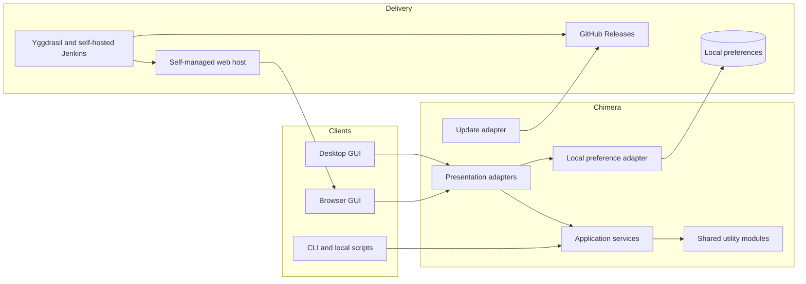
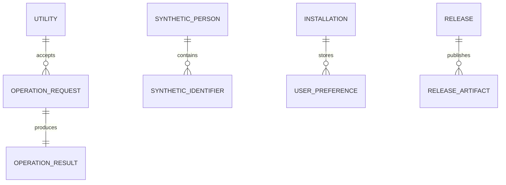
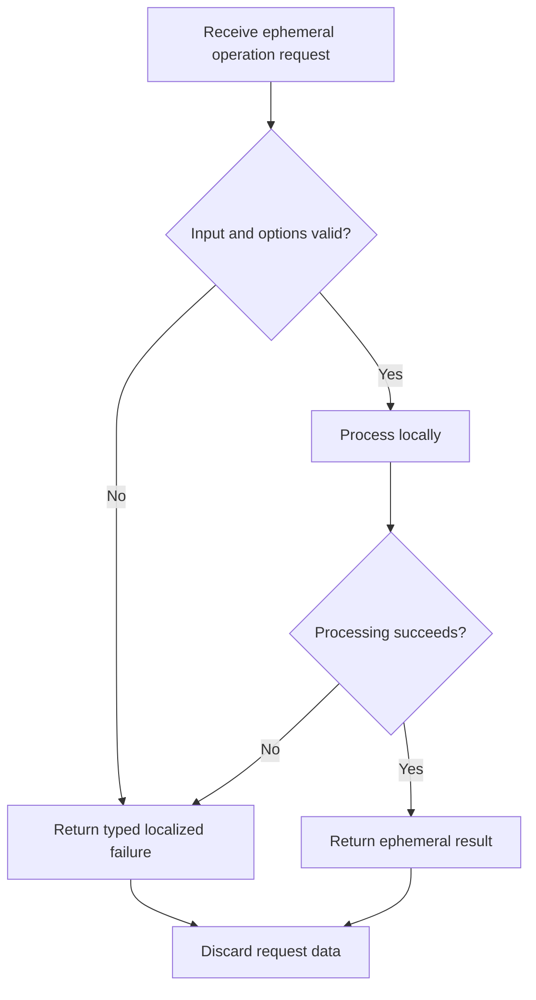

# System Requirements Document — Chimera

## 1. Introduction

### 1.1 Purpose

This document specifies the functional and non-functional requirements for
Chimera. The concrete platform, libraries, and version policy are defined in the
[Technology Stack Document](Technology%20Stack%20Document.md) and are not
restated here.

### 1.2 Scope

The system provides schedule and date tools, structured-data tools, number and
text tools, encoders and decoders, test-data generators, classical ciphers and
alphabets, localized cross-platform interfaces, local preferences, native
distribution, and guided updates.

### 1.3 Definitions

| Term | Definition |
| --- | --- |
| **Utility slug** | A stable lowercase identifier used in routes, CLI commands, logs, and traceability. |
| **Operation request** | Ephemeral input and options supplied to one utility operation. |
| **Operation result** | Ephemeral successful output or typed validation/processing failure. |
| **Machine-readable output** | A stable JSON representation intended for local automation. |
| **Interactive interface** | The browser or desktop GUI. |
| **Native distribution** | A Windows or Linux desktop or CLI portable package or installer. |

---

## 2. System Overview

The application and utility layers are shared. Only the presentation, local
preference, file/clipboard, and update adapters vary by target.

---

## 3. Functional Requirements

### 3.1 Schedule & Date (`SD`)

| ID | Requirement |
| --- | --- |
| FR-SD-01 | The system shall parse valid five-field Unix cron expressions. |
| FR-SD-02 | The system shall parse valid six-field cron expressions whose first field represents seconds. |
| FR-SD-03 | The system shall render a human-readable explanation of a valid cron expression. |
| FR-SD-04 | The system shall calculate requested previous and next cron occurrences in a selected IANA time zone. |
| FR-SD-05 | The system shall convert among ISO 8601 values, Unix seconds, Unix milliseconds, approved custom patterns, and IANA time zones. |

### 3.2 Structured Data (`DA`)

| ID | Requirement |
| --- | --- |
| FR-DA-01 | The system shall render an array of JSON objects as a tabular result. |
| FR-DA-02 | The system shall preserve nested JSON values as serialized JSON when flattening them would lose structure. |
| FR-DA-03 | The system shall serialize an array of JSON objects as standards-compliant CSV. |
| FR-DA-04 | The system shall serialize JSON-compatible values as YAML. |
| FR-DA-05 | The system shall validate and format JSON using user-selected indentation. |
| FR-DA-06 | The system shall format SQL using the selected PostgreSQL, MySQL, SQL Server, or SQLite dialect. |
| FR-DA-07 | The system shall validate and format XML using user-selected indentation. |
| FR-DA-08 | The system shall return a typed error identifying the location and reason for invalid structured-data input. |

### 3.3 Number & Text (`TX`)

| ID | Requirement |
| --- | --- |
| FR-TX-01 | The system shall convert arbitrary-precision integers between bases 2 and 36. |
| FR-TX-02 | The system shall escape text using the selected JSON, Unicode, C-style, HTML, or URL mode. |
| FR-TX-03 | The system shall unescape text using the selected JSON, Unicode, C-style, HTML, or URL mode. |
| FR-TX-04 | The system shall compare line-based lists and return left-only, right-only, intersection, and equality results. |
| FR-TX-05 | The system shall apply selected case-sensitivity, whitespace, and duplicate-handling options to list comparison. |
| FR-TX-06 | The system shall report character, word, line, and UTF-8 byte counts for text. |
| FR-TX-07 | The system shall transform text case, normalize whitespace, sort lines, and remove duplicate lines. |
| FR-TX-08 | The system shall compare text at line granularity. |
| FR-TX-09 | The system shall compare text at word granularity. |
| FR-TX-10 | The system shall compare text at character granularity. |
| FR-TX-11 | The system shall return typed validation errors for invalid numeric or text-operation options. |

### 3.4 Encoders & Decoders (`EN`)

| ID | Requirement |
| --- | --- |
| FR-EN-01 | The system shall Base64-encode text or local file bytes. |
| FR-EN-02 | The system shall Base64-decode valid input to text or local file bytes. |
| FR-EN-03 | The system shall preview image output when decoded bytes represent a supported image. |
| FR-EN-04 | The system shall inspect supported PEM, DER, or Base64 certificate input and return its locally parsed metadata. |
| FR-EN-05 | The system shall convert supported certificates among PEM, DER, and Base64 representations without altering certificate content. |
| FR-EN-06 | The system shall GZIP-compress text or local file bytes. |
| FR-EN-07 | The system shall GZIP-decompress valid local input to text or file bytes. |
| FR-EN-08 | The system shall encode text as HTML entities. |
| FR-EN-09 | The system shall decode valid HTML entities to text. |
| FR-EN-10 | The system shall create and sign JWTs locally with supported HMAC, RSA, or ECDSA algorithms. |
| FR-EN-11 | The system shall decode JWT headers and payloads and verify signatures locally when a key is supplied. |
| FR-EN-12 | The system shall keep token claims and cryptographic keys in memory and exclude them from logs. |
| FR-EN-13 | The system shall generate a QR image from text using selected QR error-correction and size options. |
| FR-EN-14 | The system shall decode a QR code from a supported local image. |
| FR-EN-15 | The system shall URL-encode a full value or component using the selected mode. |
| FR-EN-16 | The system shall URL-decode valid percent-encoded input. |
| FR-EN-17 | The system shall return a typed error for malformed, unsupported, corrupt, or unverifiable encoded input. |
| FR-EN-18 | The system shall allow binary operation results to be saved locally without retaining a second copy. |

### 3.5 Generators (`GE`)

| ID | Requirement |
| --- | --- |
| FR-GE-01 | The system shall generate SHA-256, SHA-384, and SHA-512 hashes from text or local file bytes. |
| FR-GE-02 | The system shall generate MD5 and SHA-1 hashes while labeling them as legacy and unsuitable for security decisions. |
| FR-GE-03 | The system shall generate CRC32 and Adler-32 checksums from text or local file bytes. |
| FR-GE-04 | The system shall generate Lorem Ipsum with requested paragraph, sentence, or word counts. |
| FR-GE-05 | The system shall generate passwords using requested length and character-class constraints. |
| FR-GE-06 | The system shall generate UUID version 4 identifiers. |
| FR-GE-07 | The system shall generate UUID version 7 identifiers and equivalent GUID text representations. |
| FR-GE-08 | The system shall generate synthetic Visa, Mastercard, American Express, and Discover numbers from test ranges with valid checksums. |
| FR-GE-09 | The system shall generate structurally valid SSN, ITIN, EIN, CPF, CNPJ, CNH, and CIN/RG test identifiers. |
| FR-GE-10 | The system shall apply every applicable official structural and checksum rule to generated identifiers. |
| FR-GE-11 | The system shall generate synthetic US and Brazilian people with locale-consistent names, birth dates, addresses, phones, emails, and identifiers. |
| FR-GE-12 | The system shall keep all fields within one generated person internally consistent with the selected locale. |
| FR-GE-13 | The system shall clearly label generated people, cards, and documents as synthetic test data. |

### 3.6 Ciphers & Alphabets (`CA`)

| ID | Requirement |
| --- | --- |
| FR-CA-01 | The system shall encode text using Caesar/ROT, Vigenère, Atbash, Affine, Bacon, or Rail Fence. |
| FR-CA-02 | The system shall decode text using Caesar/ROT, Vigenère, Atbash, Affine, Bacon, or Rail Fence. |
| FR-CA-03 | The system shall require and validate every key or parameter needed by the selected cipher. |
| FR-CA-04 | The system shall preserve characters outside the selected cipher alphabet according to an explicit operation option. |
| FR-CA-05 | The system shall encode text as Morse code, NATO phonetic alphabet, or Braille. |
| FR-CA-06 | The system shall decode valid Morse code, NATO phonetic alphabet, or Braille input. |
| FR-CA-07 | The system shall expose the exact alphabet mapping used by the selected operation. |
| FR-CA-08 | The system shall return a typed error for unsupported symbols, ambiguous input, or invalid cipher parameters. |

### 3.7 Platform & Localization (`PL`)

| ID | Requirement |
| --- | --- |
| FR-PL-01 | The system shall invoke one shared utility implementation from browser, desktop, and CLI adapters. |
| FR-PL-02 | The interactive interfaces shall accept text, supported local files, and clipboard data when applicable to an operation. |
| FR-PL-03 | The CLI shall expose commands in the form `chimera <utility> <operation>`. |
| FR-PL-04 | The CLI shall accept operation input through arguments, standard input, or local file flags when applicable. |
| FR-PL-05 | The CLI shall write human-readable output or a stable JSON result selected by the caller. |
| FR-PL-06 | The CLI shall use documented nonzero exit codes for validation, processing, file-access, resource, and update failures. |
| FR-PL-07 | The interactive interfaces shall let the user select and locally persist a light or dark theme. |
| FR-PL-08 | The interactive interfaces shall support English and Brazilian Portuguese and default to English. |
| FR-PL-09 | The system shall discard operation inputs and results after returning them. |
| FR-PL-10 | The system shall never transmit utility input or output off the user's device. |
| FR-PL-11 | Every utility operation shall remain usable without a network connection after the application is available locally. |

### 3.8 Distribution & Updates (`UP`)

| ID | Requirement |
| --- | --- |
| FR-UP-01 | The release process shall publish portable and installer artifacts for Windows and Linux desktop and CLI applications. |
| FR-UP-02 | An installed desktop or CLI application shall check GitHub Releases for newer compatible release metadata. |
| FR-UP-03 | The system shall compare release versions without downloading an artifact. |
| FR-UP-04 | The system shall describe an available compatible update and ask the user before downloading it. |
| FR-UP-05 | The system shall download only an update explicitly accepted by the user. |
| FR-UP-06 | The system shall verify the published checksum of a downloaded update before installation. |
| FR-UP-07 | The system shall apply a verified accepted update without requiring a manual package download. |
| FR-UP-08 | The system shall preserve the installed working version and report a typed error when checking, downloading, verifying, or applying an update fails. |

---

### 3.9 Developer Workflow (`DW`)

| ID | Requirement | Priority |
| --- | --- | --- |
| FR-DW-02 | Chimera shall provide UC-48 on supported Windows native desktop and CLI interfaces through one shared lifecycle service: launch and activate its own `cmd.exe /d` console; normalize invalid, absent, nonpositive, or out-of-range intervals to 20 seconds; wait 1 second at startup, 15 seconds initially, and the interval before each fixed sequential `echo Hello World <n>` command starting at 1; verify live console/process ownership and foreground at every scoped console-input write; stop on ownership/focus or automation failure; cancel and await cleanup without affecting unrelated windows; return a typed unsupported result on Linux and web; localize effective interval, stop count, and redacted failures in English and Brazilian Portuguese. | Must |

---

### 3.9 Developer Workflow (`DW`): UC-50

| ID | Requirement |
| --- | --- |
| FR-DW-04 | Native Windows/Linux desktop and CLI shall share a build-artifact cleanup service. Resolve the actor-selected directory (default `./src` only when it exists), discover only topmost directories named exactly `bin` or `obj` beneath it, preview the canonical root and exact directory paths, and require explicit confirmation or CLI `--yes`. Reject missing/non-directory roots, traversal, linked roots/ancestors, junctions and case aliases. Revalidate canonical scope at deletion and conservatively retain changed or unsafe paths. No matches succeeds with zero removals; access/locked failures report each retained artifact and continue within scope. Web shall explicitly report unsupported behavior. |

## 4. Data Model

### 4.0 Identifier Strategy

Chimera has no persisted domain entities. Utilities are addressed by stable,
lowercase slugs shared by routes and CLI commands. Ephemeral requests and results
have no identifiers. A native release artifact is addressed by the composite of
release version, platform, application type, and package type.

### 4.1 Entity Relationship Diagram

### 4.2 Utility Fields

| Field | Type | Constraints | Description |
| --- | --- | --- | --- |
| `slug` | String | Required, unique, lowercase | Stable route and command identifier. |
| `category` | Enum | Required | Requirement area that owns the utility. |
| `nameKey` | String | Required, unique | Localization key for the display name. |
| `operations` | Set of enums | Required, non-empty | User-visible operations exposed by the utility. |
| `interfaces` | Set of enums | Required, non-empty | Browser, desktop, and CLI support declarations. |

### 4.3 Operation Request Fields

| Field | Type | Constraints | Description |
| --- | --- | --- | --- |
| `utilitySlug` | String | Required, known slug | Utility to invoke. |
| `operation` | Enum | Required, supported by utility | Requested action. |
| `input` | String or bytes | Required when the operation consumes input | Ephemeral source value. |
| `options` | Typed map | Required, may be empty | Operation-specific parameters. |
| `locale` | BCP 47 tag | Optional; `en` or `pt-BR` | Locale for generated or presented data. |

### 4.4 Operation Result Fields

| Field | Type | Constraints | Description |
| --- | --- | --- | --- |
| `success` | Boolean | Required | Whether processing completed successfully. |
| `outputKind` | Enum | Required on success | Text, structured value, table, or bytes. |
| `output` | String, bytes, or structured value | Required on success | Ephemeral result. |
| `errorCode` | String enum | Required on failure | Stable machine-readable failure category. |
| `messageKey` | String | Required on failure | Localized diagnostic key without sensitive input. |

### 4.5 User Preference Fields

| Field | Type | Constraints | Description |
| --- | --- | --- | --- |
| `theme` | Enum | `light` or `dark`; default `light` | Persisted visual theme. |
| `language` | BCP 47 tag | `en` or `pt-BR`; default `en` | Persisted interface language. |

### 4.6 Synthetic Person Fields

| Field | Type | Constraints | Description |
| --- | --- | --- | --- |
| `locale` | Enum | Required; US or Brazil | Governs every locale-dependent field. |
| `givenName` | String | Required, non-blank | Synthetic given name. |
| `familyName` | String | Required, non-blank | Synthetic family name. |
| `birthDate` | Date | Required, valid calendar date | Synthetic date of birth. |
| `address` | Structured value | Required, locale-consistent | Street, locality, region, postal code, and country. |
| `phone` | String | Required, locale-consistent | Synthetic telephone number. |
| `email` | String | Required, syntactically valid | Synthetic non-claiming email value. |
| `identifiers` | List of Synthetic Identifier | Required | Matching locale-specific test identifiers. |

### 4.7 Synthetic Identifier Fields

| Field | Type | Constraints | Description |
| --- | --- | --- | --- |
| `locale` | Enum | Required; US or Brazil | Issuing locale. |
| `type` | Enum | Required; approved document/card type | Identifier kind. |
| `value` | String | Required; structurally valid | Generated test value. |
| `synthetic` | Boolean | Required and true | Prevents presentation as a real-world record. |

### 4.8 Release Artifact Fields

| Field | Type | Constraints | Description |
| --- | --- | --- | --- |
| `releaseVersion` | Semantic version | Required | Published application version. |
| `platform` | Enum | Required; Windows or Linux | Target operating system. |
| `application` | Enum | Required; desktop or CLI | Delivered interface. |
| `packageType` | Enum | Required; portable or installer | Distribution form. |
| `downloadUrl` | HTTPS URL | Required | GitHub-hosted artifact location. |
| `checksum` | String | Required | Integrity value verified before installation. |

---

## 5. Interface and Command Surface

### 5.1 Interactive Interface

The browser and desktop applications organize utilities by the eight requirement
areas, provide searchable utility routes, use localized labels and validation,
and expose text, file, clipboard, preview, copy, and save interactions only where
the selected operation supports them.

### 5.2 CLI Commands

| Command | Operation | Requirement |
| --- | --- | --- |
| `chimera cron parse` | Parse and explain a cron expression | FR-SD-01–FR-SD-04 |
| `chimera date convert` | Convert date, epoch, format, or time zone | FR-SD-05 |
| `chimera json array-to-table` | Render JSON-array rows as a table | FR-DA-01–FR-DA-02 |
| `chimera json array-to-csv` | Convert a JSON array to CSV | FR-DA-02–FR-DA-03 |
| `chimera json to-yaml` | Convert JSON to YAML | FR-DA-04 |
| `chimera json format` | Validate and format JSON | FR-DA-05 |
| `chimera sql format` | Format SQL for a selected dialect | FR-DA-06 |
| `chimera xml format` | Validate and format XML | FR-DA-07 |
| `chimera number convert-base` | Convert an integer among bases | FR-TX-01 |
| `chimera text escape` | Escape text in a selected mode | FR-TX-02 |
| `chimera text unescape` | Unescape text in a selected mode | FR-TX-03 |
| `chimera list compare` | Compare two line-based lists | FR-TX-04–FR-TX-05 |
| `chimera text analyze` | Calculate text counts | FR-TX-06 |
| `chimera text transform` | Apply a selected text transformation | FR-TX-07 |
| `chimera text compare` | Compare text at selected granularity | FR-TX-08–FR-TX-10 |
| `chimera base64 encode` | Encode text or file bytes | FR-EN-01 |
| `chimera base64 decode` | Decode Base64 input | FR-EN-02–FR-EN-03 |
| `chimera certificate inspect` | Inspect certificate metadata | FR-EN-04 |
| `chimera certificate convert` | Convert certificate representation | FR-EN-05 |
| `chimera gzip compress` | Compress text or file bytes | FR-EN-06 |
| `chimera gzip decompress` | Decompress GZIP input | FR-EN-07 |
| `chimera html encode` | Encode HTML entities | FR-EN-08 |
| `chimera html decode` | Decode HTML entities | FR-EN-09 |
| `chimera jwt create` | Create and sign a JWT | FR-EN-10–FR-EN-12 |
| `chimera jwt inspect` | Decode and optionally verify a JWT | FR-EN-11–FR-EN-12 |
| `chimera qr encode` | Generate a QR image | FR-EN-13 |
| `chimera qr decode` | Decode a QR image | FR-EN-14 |
| `chimera url encode` | URL-encode a value | FR-EN-15 |
| `chimera url decode` | URL-decode a value | FR-EN-16 |
| `chimera hash generate` | Calculate a cryptographic hash | FR-GE-01–FR-GE-02 |
| `chimera checksum generate` | Calculate a checksum | FR-GE-03 |
| `chimera lorem generate` | Generate Lorem Ipsum | FR-GE-04 |
| `chimera password generate` | Generate a constrained password | FR-GE-05 |
| `chimera uuid generate` | Generate UUID/GUID values | FR-GE-06–FR-GE-07 |
| `chimera card generate` | Generate a synthetic card number | FR-GE-08, FR-GE-10, FR-GE-13 |
| `chimera document generate` | Generate a synthetic identity document | FR-GE-09–FR-GE-10, FR-GE-13 |
| `chimera person generate` | Generate a locale-consistent synthetic person | FR-GE-11–FR-GE-13 |
| `chimera cipher encode` | Encode using a classical cipher | FR-CA-01, FR-CA-03–FR-CA-04 |
| `chimera cipher decode` | Decode using a classical cipher | FR-CA-02–FR-CA-04 |
| `chimera alphabet encode` | Encode using a representation alphabet | FR-CA-05, FR-CA-07 |
| `chimera alphabet decode` | Decode a representation alphabet | FR-CA-06–FR-CA-07 |
| `chimera dotnet clean [--root=<directory>] [--yes]` | Preview and explicitly confirm removal of build artifacts; default `./src` | FR-DW-04 |
| `chimera update check` | Check for a compatible update | FR-UP-02–FR-UP-04 |
| `chimera update apply` | Download, verify, and apply an accepted update | FR-UP-05–FR-UP-08 |

Every utility command also realizes FR-PL-01 and FR-PL-03 through FR-PL-06.

---

## 6. Non-Functional Requirements

| ID | Category | Requirement |
| --- | --- | --- |
| NFR-01 | Privacy | The system shall process utility inputs and outputs only on the user's device. |
| NFR-02 | Offline operation | The system shall execute every utility without a network dependency after installation or initial web loading. |
| NFR-03 | Data minimization | The system shall retain no operation input, output, history, analytics, or telemetry. |
| NFR-04 | Compatibility | The web functional suite shall pass in Chromium, Firefox, and Safari. |
| NFR-05 | Compatibility | The desktop and CLI functional suites shall pass on Windows and Linux. |
| NFR-06 | Localization | Every user-facing GUI message shall be available in English and Brazilian Portuguese. |
| NFR-07 | Accessibility | The interactive interfaces shall satisfy applicable WCAG 2.2 Level AA criteria. |
| NFR-08 | Reliability | A failed operation shall return a typed diagnostic and shall not expose a partial result as successful. |
| NFR-09 | Security | Logs shall exclude utility inputs, outputs, cryptographic keys, tokens, and generated personal data. |
| NFR-10 | Testability | Every functional requirement, business rule, main flow, alternative flow, supported target, and localization path shall have automated coverage. |
| NFR-11 | Performance | Representative workloads and numeric acceptance thresholds shall be defined and enforced before the first production release. |
| NFR-12 | Availability | A production availability objective and measurement window shall be defined before the first production release. |
| NFR-13 | Maintainability | A utility algorithm shall have one shared implementation used by all supported interfaces. |

---

## 8. Operation and Update Lifecycle Strategy

Preferences are written only when the user changes theme or language. Update
metadata is fetched without utility data; an artifact is downloaded only after
approval, verified before application, and discarded or rolled back on failure.

---

## 9. Traceability

### 9.1 Features

| Feature | Requirements |
| --- | --- |
| F-01 Schedule and date tools | FR-SD-01 through FR-SD-05 |
| F-02 Structured-data tools | FR-DA-01 through FR-DA-08 |
| F-03 Number and text tools | FR-TX-01 through FR-TX-11 |
| F-04 Encoders and decoders | FR-EN-01 through FR-EN-18 |
| F-05 Test-data generators | FR-GE-01 through FR-GE-13 |
| F-06 Ciphers and alphabets | FR-CA-01 through FR-CA-08 |
| F-07 Cross-platform interfaces | FR-PL-01 through FR-PL-11 |
| F-08 Distribution and updates | FR-UP-01 through FR-UP-08 |

### 9.2 Business Rules

| Business Rule | Realized by |
| --- | --- |
| BR-01 | FR-SD-01–FR-SD-05, FR-DA-01–FR-DA-08, FR-TX-01–FR-TX-11, FR-EN-01–FR-EN-18, FR-GE-01–FR-GE-13, FR-CA-01–FR-CA-08 |
| BR-02 | FR-PL-01–FR-PL-06 |
| BR-03 | FR-PL-11, NFR-02 |
| BR-04 | FR-PL-10, NFR-01 |
| BR-05 | FR-PL-09, NFR-03 |
| BR-06 | FR-PL-07–FR-PL-08 |
| BR-07 | FR-PL-08, NFR-06 |
| BR-08 | NFR-04 |
| BR-09 | FR-UP-01, NFR-05 |
| BR-10 | FR-GE-08–FR-GE-13 |
| BR-11 | FR-GE-08–FR-GE-10 |
| BR-12 | FR-GE-09–FR-GE-10 |
| BR-13 | FR-GE-11–FR-GE-13 |
| BR-14 | FR-CA-01–FR-CA-04 |
| BR-15 | FR-CA-05–FR-CA-08 |
| BR-16 | FR-UP-01 |
| BR-17 | FR-UP-02–FR-UP-08 |
| BR-18 | NFR-10 |
| BR-19 | FR-PL-09–FR-PL-11 |

## Developer Workflow Automation

| ID | Requirement |
| --- | --- |
| FR-DW-01 | Create a new native project from the offline, versioned canonical project-template snapshot, preserve hidden files, exclude Git metadata, validate destination access/conflicts before creation, and safely remove owned partial output after rendering or write failures. Desktop and CLI consume one shared service; unsupported targets return a typed result. |

### Developer Workflows — UC-49

| ID | Requirement | Priority |
| --- | --- | --- |
| FR-DW-03 | Restore and build a selected `.sln` through one shared native service. Default to `./src`, automatic single-solution discovery, restoration enabled, and Debug followed by Release. Accept explicit solution, Debug/Release configuration, and no-restore mode. Validate discovery and SDK availability before building; stop on external failure, return its exit status, stream bounded/redacted diagnostics, and terminate the process tree on cancellation. CLI and Windows/Linux desktop are supported; web explicitly reports unsupported. | Must |

Traceability: [UC-49 issue #98](https://github.com/artur-rios/chimera/issues/98),
[PowerShell build](https://github.com/artur-rios/dotnet-tools/blob/7cd0a4867dbbd0301ddb5e6a207fbb0b29c56998/commands/build.ps1),
[Python build](https://github.com/artur-rios/python-dotnet-tools/blob/c7255b386ca49a40cbafde7c6e4edd29b25fdebf/src/commands/build.py).
