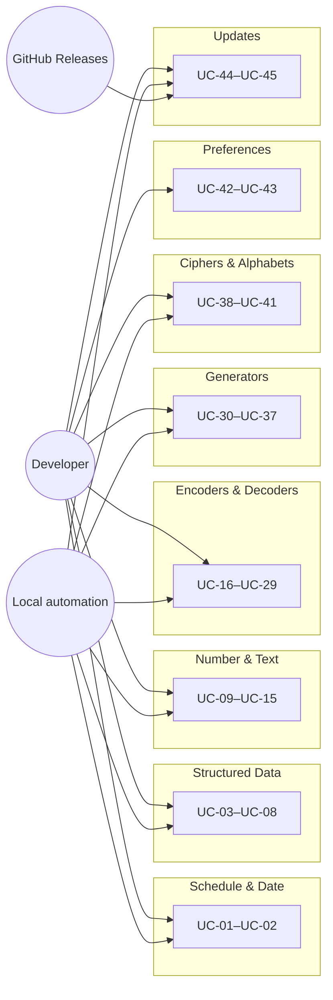
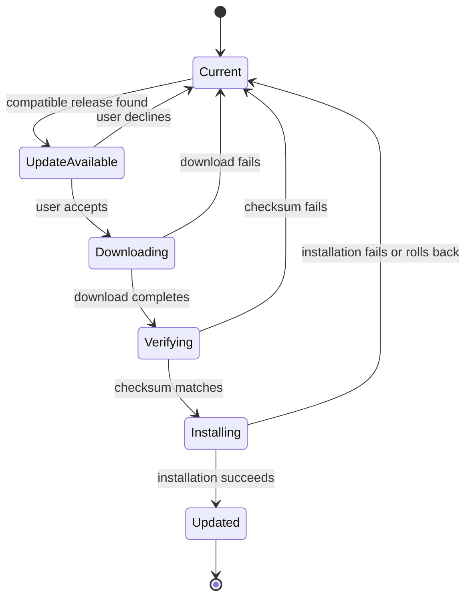

# Use Case Specification Document — Chimera

## 1. Introduction

### 1.1 Purpose

This document specifies Chimera's user-visible use cases. Each use case describes
its actors, preconditions, postconditions, main flow, alternative flows, and
requirements. Utility use cases share the same local-processing boundary: request
data is validated, processed locally, returned, and discarded.

### 1.2 Actors

| Actor | Description |
| --- | --- |
| **Developer** | Uses the browser, desktop, or CLI interface interactively. |
| **Local automation** | Invokes CLI commands and consumes deterministic text or JSON output. |
| **GitHub Releases** | Supplies native release metadata, checksums, and accepted update artifacts; receives no utility data. |

### 1.3 Use Case Overview

---

## 2. Use Case Specifications

### UC-01: Parse Cron Expression

| Field | Value |
| --- | --- |
| **ID** | UC-01 |
| **Actors** | Developer, Local automation |
| **Description** | Explain a cron expression and calculate occurrences in a selected time zone. |
| **Preconditions** | Chimera is available locally. |
| **Postconditions** | The explanation and requested occurrences are returned; input is discarded. |
| **Requirements** | FR-SD-01–FR-SD-04, FR-PL-01–FR-PL-06, FR-PL-09–FR-PL-11 |

**Main Flow**

1. The actor supplies a five- or six-field expression, time zone, and occurrence count.
2. Chimera validates and explains the expression, then calculates occurrences.
3. Chimera returns the localized or machine-readable result and discards the request.

**Alternative Flows**

| ID | Condition | Outcome |
| --- | --- | --- |
| AF-01 | The expression, time zone, or count is invalid. | Return a typed validation failure with no occurrences. |
| AF-02 | Calculation exceeds available resources. | Return a resource failure and discard intermediate data. |

### UC-02: Convert Date

| Field | Value |
| --- | --- |
| **ID** | UC-02 |
| **Actors** | Developer, Local automation |
| **Description** | Convert a date among epochs, formats, and IANA time zones. |
| **Preconditions** | Chimera is available locally. |
| **Postconditions** | The converted date is returned; input is discarded. |
| **Requirements** | FR-SD-05, FR-PL-01–FR-PL-06, FR-PL-09–FR-PL-11 |

**Main Flow**

1. The actor supplies a date, source representation, target representation, and time zones.
2. Chimera validates the value and performs the conversion with the selected calendar rules.
3. Chimera returns the result and discards the request.

**Alternative Flows**

| ID | Condition | Outcome |
| --- | --- | --- |
| AF-01 | A date, pattern, epoch, or time zone is invalid or ambiguous. | Return a typed validation failure. |
| AF-02 | The value is outside the supported date range. | Return a range failure without a partial result. |

### UC-03: Convert JSON Array to Table

| Field | Value |
| --- | --- |
| **ID** | UC-03 |
| **Actors** | Developer, Local automation |
| **Description** | Render JSON-object array rows and columns as a table. |
| **Preconditions** | Chimera is available locally. |
| **Postconditions** | A table is returned and the source is discarded. |
| **Requirements** | FR-DA-01–FR-DA-02, FR-DA-08, FR-PL-01–FR-PL-06, FR-PL-09–FR-PL-11 |

**Main Flow**

1. The actor supplies a JSON array and display options.
2. Chimera validates the array, derives columns, and preserves nested values as JSON.
3. Chimera returns the table and discards the request.

**Alternative Flows**

| ID | Condition | Outcome |
| --- | --- | --- |
| AF-01 | The input is invalid JSON or not an object array. | Return a location-aware validation failure. |
| AF-02 | Rendering exceeds available resources. | Return a resource failure without a partial table. |

### UC-04: Convert JSON Array to CSV

| Field | Value |
| --- | --- |
| **ID** | UC-04 |
| **Actors** | Developer, Local automation |
| **Description** | Serialize JSON-object array rows as CSV. |
| **Preconditions** | Chimera is available locally. |
| **Postconditions** | CSV text or a local file result is returned; source input is discarded. |
| **Requirements** | FR-DA-02–FR-DA-03, FR-DA-08, FR-PL-01–FR-PL-06, FR-PL-09–FR-PL-11 |

**Main Flow**

1. The actor supplies a JSON array and CSV delimiter/header options.
2. Chimera validates and serializes the rows with standards-compliant quoting.
3. Chimera returns or saves the CSV and discards the request.

**Alternative Flows**

| ID | Condition | Outcome |
| --- | --- | --- |
| AF-01 | JSON or CSV options are invalid. | Return a location-aware validation failure. |
| AF-02 | The selected output file cannot be written. | Return a file-access failure and keep no output copy. |

### UC-05: Convert JSON to YAML

| Field | Value |
| --- | --- |
| **ID** | UC-05 |
| **Actors** | Developer, Local automation |
| **Description** | Serialize a JSON-compatible value as YAML. |
| **Preconditions** | Chimera is available locally. |
| **Postconditions** | YAML is returned and source input is discarded. |
| **Requirements** | FR-DA-04, FR-DA-08, FR-PL-01–FR-PL-06, FR-PL-09–FR-PL-11 |

**Main Flow**

1. The actor supplies JSON and formatting options.
2. Chimera validates the input and serializes it as YAML.
3. Chimera returns the YAML and discards the request.

**Alternative Flows**

| ID | Condition | Outcome |
| --- | --- | --- |
| AF-01 | The JSON is invalid. | Return a location-aware validation failure. |
| AF-02 | Serialization exceeds available resources. | Return a resource failure without partial YAML. |

### UC-06: Format JSON

| Field | Value |
| --- | --- |
| **ID** | UC-06 |
| **Actors** | Developer, Local automation |
| **Description** | Validate and indent JSON. |
| **Preconditions** | Chimera is available locally. |
| **Postconditions** | Formatted JSON is returned and input is discarded. |
| **Requirements** | FR-DA-05, FR-DA-08, FR-PL-01–FR-PL-06, FR-PL-09–FR-PL-11 |

**Main Flow**

1. The actor supplies JSON and indentation options.
2. Chimera validates and formats the value.
3. Chimera returns the formatted JSON and discards the request.

**Alternative Flows**

| ID | Condition | Outcome |
| --- | --- | --- |
| AF-01 | JSON or indentation options are invalid. | Return a location-aware validation failure. |
| AF-02 | Clipboard or output-file access fails. | Return an access failure and retain no result. |

### UC-07: Format SQL

| Field | Value |
| --- | --- |
| **ID** | UC-07 |
| **Actors** | Developer, Local automation |
| **Description** | Format SQL for a selected supported dialect. |
| **Preconditions** | Chimera is available locally. |
| **Postconditions** | Formatted SQL is returned and input is discarded. |
| **Requirements** | FR-DA-06, FR-DA-08, FR-PL-01–FR-PL-06, FR-PL-09–FR-PL-11 |

**Main Flow**

1. The actor supplies SQL, a dialect, and formatting options.
2. Chimera validates the selected dialect and formats the statement locally.
3. Chimera returns the formatted SQL and discards the request.

**Alternative Flows**

| ID | Condition | Outcome |
| --- | --- | --- |
| AF-01 | The dialect or SQL structure is unsupported. | Return a location-aware validation failure. |
| AF-02 | Formatting exceeds available resources. | Return a resource failure without partial output. |

### UC-08: Format XML

| Field | Value |
| --- | --- |
| **ID** | UC-08 |
| **Actors** | Developer, Local automation |
| **Description** | Validate and indent XML. |
| **Preconditions** | Chimera is available locally. |
| **Postconditions** | Formatted XML is returned and input is discarded. |
| **Requirements** | FR-DA-07–FR-DA-08, FR-PL-01–FR-PL-06, FR-PL-09–FR-PL-11 |

**Main Flow**

1. The actor supplies XML and indentation options.
2. Chimera validates and formats the document.
3. Chimera returns the XML and discards the request.

**Alternative Flows**

| ID | Condition | Outcome |
| --- | --- | --- |
| AF-01 | XML or indentation options are invalid. | Return a location-aware validation failure. |
| AF-02 | Clipboard or output-file access fails. | Return an access failure and retain no result. |

### UC-09: Convert Number Base

| Field | Value |
| --- | --- |
| **ID** | UC-09 |
| **Actors** | Developer, Local automation |
| **Description** | Convert an arbitrary-precision integer between bases. |
| **Preconditions** | Chimera is available locally. |
| **Postconditions** | The converted representation is returned and input is discarded. |
| **Requirements** | FR-TX-01, FR-TX-11, FR-PL-01–FR-PL-06, FR-PL-09–FR-PL-11 |

**Main Flow**

1. The actor supplies a value, source base, and target base.
2. Chimera validates and converts the integer.
3. Chimera returns the converted representation and discards the request.

**Alternative Flows**

| ID | Condition | Outcome |
| --- | --- | --- |
| AF-01 | A base is outside 2–36 or a digit is invalid for its base. | Return a typed validation failure. |
| AF-02 | Conversion exceeds available resources. | Return a resource failure without partial output. |

### UC-10: Escape Text

| Field | Value |
| --- | --- |
| **ID** | UC-10 |
| **Actors** | Developer, Local automation |
| **Description** | Escape text using a supported mode. |
| **Preconditions** | Chimera is available locally. |
| **Postconditions** | Escaped text is returned and source input is discarded. |
| **Requirements** | FR-TX-02, FR-TX-11, FR-PL-01–FR-PL-06, FR-PL-09–FR-PL-11 |

**Main Flow**

1. The actor supplies text and an escape mode.
2. Chimera validates the mode and escapes the text.
3. Chimera returns the result and discards the request.

**Alternative Flows**

| ID | Condition | Outcome |
| --- | --- | --- |
| AF-01 | The mode or options are invalid. | Return a typed validation failure. |
| AF-02 | Clipboard or output-file access fails. | Return an access failure and retain no result. |

### UC-11: Unescape Text

| Field | Value |
| --- | --- |
| **ID** | UC-11 |
| **Actors** | Developer, Local automation |
| **Description** | Unescape text using a supported mode. |
| **Preconditions** | Chimera is available locally. |
| **Postconditions** | Unescaped text is returned and source input is discarded. |
| **Requirements** | FR-TX-03, FR-TX-11, FR-PL-01–FR-PL-06, FR-PL-09–FR-PL-11 |

**Main Flow**

1. The actor supplies text and an unescape mode.
2. Chimera validates and decodes escape sequences.
3. Chimera returns the result and discards the request.

**Alternative Flows**

| ID | Condition | Outcome |
| --- | --- | --- |
| AF-01 | The input contains malformed escape sequences. | Return a typed validation failure. |
| AF-02 | Clipboard or output-file access fails. | Return an access failure and retain no result. |

### UC-12: Compare Lists

| Field | Value |
| --- | --- |
| **ID** | UC-12 |
| **Actors** | Developer, Local automation |
| **Description** | Compare two line-based lists with normalization options. |
| **Preconditions** | Chimera is available locally. |
| **Postconditions** | Left-only, right-only, intersection, and equality results are returned. |
| **Requirements** | FR-TX-04–FR-TX-05, FR-TX-11, FR-PL-01–FR-PL-06, FR-PL-09–FR-PL-11 |

**Main Flow**

1. The actor supplies two lists and comparison options.
2. Chimera normalizes and compares the lists.
3. Chimera returns all comparison sets and discards the inputs.

**Alternative Flows**

| ID | Condition | Outcome |
| --- | --- | --- |
| AF-01 | Comparison options are contradictory or invalid. | Return a typed validation failure. |
| AF-02 | Comparison exceeds available resources. | Return a resource failure without partial sets. |

### UC-13: Analyze Text

| Field | Value |
| --- | --- |
| **ID** | UC-13 |
| **Actors** | Developer, Local automation |
| **Description** | Calculate text character, word, line, and byte counts. |
| **Preconditions** | Chimera is available locally. |
| **Postconditions** | Counts are returned and input is discarded. |
| **Requirements** | FR-TX-06, FR-TX-11, FR-PL-01–FR-PL-06, FR-PL-09–FR-PL-11 |

**Main Flow**

1. The actor supplies text.
2. Chimera applies the documented Unicode and line-boundary rules.
3. Chimera returns all counts and discards the request.

**Alternative Flows**

| ID | Condition | Outcome |
| --- | --- | --- |
| AF-01 | File or clipboard input cannot be read. | Return an access failure. |
| AF-02 | Analysis exceeds available resources. | Return a resource failure without partial counts. |

### UC-14: Transform Text

| Field | Value |
| --- | --- |
| **ID** | UC-14 |
| **Actors** | Developer, Local automation |
| **Description** | Apply case, whitespace, sorting, or deduplication transformations. |
| **Preconditions** | Chimera is available locally. |
| **Postconditions** | Transformed text is returned and input is discarded. |
| **Requirements** | FR-TX-07, FR-TX-11, FR-PL-01–FR-PL-06, FR-PL-09–FR-PL-11 |

**Main Flow**

1. The actor supplies text and one ordered transformation selection.
2. Chimera validates and applies the transformation.
3. Chimera returns the result and discards the request.

**Alternative Flows**

| ID | Condition | Outcome |
| --- | --- | --- |
| AF-01 | The transformation or options are invalid. | Return a typed validation failure. |
| AF-02 | Output access fails. | Return an access failure and retain no result. |

### UC-15: Compare Text

| Field | Value |
| --- | --- |
| **ID** | UC-15 |
| **Actors** | Developer, Local automation |
| **Description** | Compare two texts at line, word, or character granularity. |
| **Preconditions** | Chimera is available locally. |
| **Postconditions** | A structured difference result is returned; both inputs are discarded. |
| **Requirements** | FR-TX-08–FR-TX-11, FR-PL-01–FR-PL-06, FR-PL-09–FR-PL-11 |

**Main Flow**

1. The actor supplies two texts and a comparison granularity.
2. Chimera validates and calculates additions, removals, and unchanged spans.
3. Chimera returns the difference result and discards both inputs.

**Alternative Flows**

| ID | Condition | Outcome |
| --- | --- | --- |
| AF-01 | The granularity or options are invalid. | Return a typed validation failure. |
| AF-02 | Comparison exceeds available resources. | Return a resource failure without a partial diff. |

### UC-16: Base64 Encode

| Field | Value |
| --- | --- |
| **ID** | UC-16 |
| **Actors** | Developer, Local automation |
| **Description** | Base64-encode text or local file bytes. |
| **Preconditions** | Chimera is available locally. |
| **Postconditions** | Base64 text is returned; input bytes are discarded. |
| **Requirements** | FR-EN-01, FR-EN-17–FR-EN-18, FR-PL-01–FR-PL-06, FR-PL-09–FR-PL-11 |

**Main Flow**

1. The actor supplies text or a local file.
2. Chimera reads and encodes the bytes locally.
3. Chimera returns or saves the Base64 result and discards the source.

**Alternative Flows**

| ID | Condition | Outcome |
| --- | --- | --- |
| AF-01 | The source file cannot be read. | Return a file-access failure. |
| AF-02 | Encoding exceeds available resources. | Return a resource failure without partial output. |

### UC-17: Base64 Decode

| Field | Value |
| --- | --- |
| **ID** | UC-17 |
| **Actors** | Developer, Local automation |
| **Description** | Decode Base64 to text, bytes, or an image preview. |
| **Preconditions** | Chimera is available locally. |
| **Postconditions** | Decoded output is returned or saved; inputs are discarded. |
| **Requirements** | FR-EN-02–FR-EN-03, FR-EN-17–FR-EN-18, FR-PL-01–FR-PL-06, FR-PL-09–FR-PL-11 |

**Main Flow**

1. The actor supplies Base64 and chooses text or binary output.
2. Chimera validates, decodes, and previews supported images when applicable.
3. Chimera returns or saves the bytes and discards the request.

**Alternative Flows**

| ID | Condition | Outcome |
| --- | --- | --- |
| AF-01 | Base64 or text decoding is malformed. | Return a typed validation failure. |
| AF-02 | The output file cannot be written. | Return a file-access failure and retain no copy. |

### UC-18: Inspect Certificate

| Field | Value |
| --- | --- |
| **ID** | UC-18 |
| **Actors** | Developer, Local automation |
| **Description** | Parse local certificate input and report metadata. |
| **Preconditions** | Chimera is available locally. |
| **Postconditions** | Parsed metadata is returned; certificate input is discarded. |
| **Requirements** | FR-EN-04, FR-EN-17, FR-PL-01–FR-PL-06, FR-PL-09–FR-PL-11 |

**Main Flow**

1. The actor supplies PEM, DER, or Base64 certificate data.
2. Chimera parses supported fields locally.
3. Chimera returns metadata and discards the certificate bytes.

**Alternative Flows**

| ID | Condition | Outcome |
| --- | --- | --- |
| AF-01 | The representation is malformed or unsupported. | Return a certificate validation failure. |
| AF-02 | File input cannot be read. | Return a file-access failure. |

### UC-19: Convert Certificate

| Field | Value |
| --- | --- |
| **ID** | UC-19 |
| **Actors** | Developer, Local automation |
| **Description** | Convert certificate representation without altering its content. |
| **Preconditions** | Chimera is available locally. |
| **Postconditions** | The converted representation is returned or saved; source bytes are discarded. |
| **Requirements** | FR-EN-05, FR-EN-17–FR-EN-18, FR-PL-01–FR-PL-06, FR-PL-09–FR-PL-11 |

**Main Flow**

1. The actor supplies a supported certificate and target representation.
2. Chimera validates and converts the representation locally.
3. Chimera returns or saves the output and discards the request.

**Alternative Flows**

| ID | Condition | Outcome |
| --- | --- | --- |
| AF-01 | The source or target representation is invalid. | Return a certificate validation failure. |
| AF-02 | The output file cannot be written. | Return a file-access failure and retain no copy. |

### UC-20: GZIP Compress

| Field | Value |
| --- | --- |
| **ID** | UC-20 |
| **Actors** | Developer, Local automation |
| **Description** | Compress text or local file bytes using GZIP. |
| **Preconditions** | Chimera is available locally. |
| **Postconditions** | Compressed bytes are returned or saved; source bytes are discarded. |
| **Requirements** | FR-EN-06, FR-EN-17–FR-EN-18, FR-PL-01–FR-PL-06, FR-PL-09–FR-PL-11 |

**Main Flow**

1. The actor supplies text or a local file and compression options.
2. Chimera validates and compresses the bytes locally.
3. Chimera returns or saves the archive and discards the source.

**Alternative Flows**

| ID | Condition | Outcome |
| --- | --- | --- |
| AF-01 | Input or compression options are invalid. | Return a typed validation failure. |
| AF-02 | File access or resources are insufficient. | Return the applicable failure without partial output. |

### UC-21: GZIP Decompress

| Field | Value |
| --- | --- |
| **ID** | UC-21 |
| **Actors** | Developer, Local automation |
| **Description** | Decompress valid GZIP bytes. |
| **Preconditions** | Chimera is available locally. |
| **Postconditions** | Decompressed bytes are returned or saved; source bytes are discarded. |
| **Requirements** | FR-EN-07, FR-EN-17–FR-EN-18, FR-PL-01–FR-PL-06, FR-PL-09–FR-PL-11 |

**Main Flow**

1. The actor supplies local GZIP data and an output mode.
2. Chimera validates and decompresses the data locally.
3. Chimera returns or saves the output and discards the request.

**Alternative Flows**

| ID | Condition | Outcome |
| --- | --- | --- |
| AF-01 | The archive is malformed, corrupt, or unsupported. | Return a typed decoding failure. |
| AF-02 | File access or resources are insufficient. | Return the applicable failure without partial output. |

### UC-22: HTML Encode

| Field | Value |
| --- | --- |
| **ID** | UC-22 |
| **Actors** | Developer, Local automation |
| **Description** | Encode text using HTML entities. |
| **Preconditions** | Chimera is available locally. |
| **Postconditions** | Encoded text is returned and input is discarded. |
| **Requirements** | FR-EN-08, FR-EN-17, FR-PL-01–FR-PL-06, FR-PL-09–FR-PL-11 |

**Main Flow**

1. The actor supplies text and entity options.
2. Chimera validates and encodes the text.
3. Chimera returns the result and discards the request.

**Alternative Flows**

| ID | Condition | Outcome |
| --- | --- | --- |
| AF-01 | Entity options are invalid. | Return a typed validation failure. |
| AF-02 | Output access fails. | Return an access failure and retain no result. |

### UC-23: HTML Decode

| Field | Value |
| --- | --- |
| **ID** | UC-23 |
| **Actors** | Developer, Local automation |
| **Description** | Decode HTML entities to text. |
| **Preconditions** | Chimera is available locally. |
| **Postconditions** | Decoded text is returned and input is discarded. |
| **Requirements** | FR-EN-09, FR-EN-17, FR-PL-01–FR-PL-06, FR-PL-09–FR-PL-11 |

**Main Flow**

1. The actor supplies entity-encoded text.
2. Chimera validates and decodes recognized entities.
3. Chimera returns the text and discards the request.

**Alternative Flows**

| ID | Condition | Outcome |
| --- | --- | --- |
| AF-01 | The input contains malformed entities. | Return a typed decoding failure. |
| AF-02 | Output access fails. | Return an access failure and retain no result. |

### UC-24: Create and Sign JWT

| Field | Value |
| --- | --- |
| **ID** | UC-24 |
| **Actors** | Developer, Local automation |
| **Description** | Create and locally sign a JWT. |
| **Preconditions** | Chimera is available locally; the actor possesses any required key. |
| **Postconditions** | A signed token is returned; claims and keys are discarded. |
| **Requirements** | FR-EN-10, FR-EN-12, FR-EN-17, FR-PL-01–FR-PL-06, FR-PL-09–FR-PL-11 |

**Main Flow**

1. The actor supplies header, claims, algorithm, and a compatible local key.
2. Chimera validates and signs the token locally.
3. Chimera returns the JWT and removes claims and key material from memory.

**Alternative Flows**

| ID | Condition | Outcome |
| --- | --- | --- |
| AF-01 | Claims, algorithm, or key are invalid or incompatible. | Return a typed signing failure. |
| AF-02 | File access or cryptographic processing fails. | Return the applicable failure without logging sensitive data. |

### UC-25: Inspect and Verify JWT

| Field | Value |
| --- | --- |
| **ID** | UC-25 |
| **Actors** | Developer, Local automation |
| **Description** | Decode a JWT and optionally verify its signature locally. |
| **Preconditions** | Chimera is available locally. |
| **Postconditions** | Header, claims, and verification outcome are returned; sensitive input is discarded. |
| **Requirements** | FR-EN-11–FR-EN-12, FR-EN-17, FR-PL-01–FR-PL-06, FR-PL-09–FR-PL-11 |

**Main Flow**

1. The actor supplies a JWT and, when verification is requested, a local key.
2. Chimera decodes the token and verifies the signature locally.
3. Chimera returns parsed data and status, then removes token and key data from memory.

**Alternative Flows**

| ID | Condition | Outcome |
| --- | --- | --- |
| AF-01 | Token structure or key material is invalid. | Return a typed decoding or verification failure. |
| AF-02 | The signature does not verify. | Return parsed non-trusted data with an explicit failed status. |

### UC-26: Encode QR Code

| Field | Value |
| --- | --- |
| **ID** | UC-26 |
| **Actors** | Developer, Local automation |
| **Description** | Generate a QR image from text. |
| **Preconditions** | Chimera is available locally. |
| **Postconditions** | A QR image is returned or saved; input is discarded. |
| **Requirements** | FR-EN-13, FR-EN-17–FR-EN-18, FR-PL-01–FR-PL-06, FR-PL-09–FR-PL-11 |

**Main Flow**

1. The actor supplies text, error-correction, size, and image options.
2. Chimera validates and renders the QR image locally.
3. Chimera returns or saves the image and discards the request.

**Alternative Flows**

| ID | Condition | Outcome |
| --- | --- | --- |
| AF-01 | Content or QR options exceed the supported capacity. | Return a typed validation failure. |
| AF-02 | The output file cannot be written. | Return a file-access failure and retain no copy. |

### UC-27: Decode QR Code

| Field | Value |
| --- | --- |
| **ID** | UC-27 |
| **Actors** | Developer, Local automation |
| **Description** | Decode a QR code from a local image. |
| **Preconditions** | Chimera is available locally. |
| **Postconditions** | Decoded text is returned; image bytes are discarded. |
| **Requirements** | FR-EN-14, FR-EN-17, FR-PL-01–FR-PL-06, FR-PL-09–FR-PL-11 |

**Main Flow**

1. The actor supplies a supported local image.
2. Chimera detects and decodes a QR symbol locally.
3. Chimera returns its content and discards the image bytes.

**Alternative Flows**

| ID | Condition | Outcome |
| --- | --- | --- |
| AF-01 | The image is unsupported, corrupt, or contains no decodable QR code. | Return a typed decoding failure. |
| AF-02 | The image file cannot be read. | Return a file-access failure. |

### UC-28: URL Encode

| Field | Value |
| --- | --- |
| **ID** | UC-28 |
| **Actors** | Developer, Local automation |
| **Description** | Percent-encode a full value or URL component. |
| **Preconditions** | Chimera is available locally. |
| **Postconditions** | Encoded text is returned and input is discarded. |
| **Requirements** | FR-EN-15, FR-EN-17, FR-PL-01–FR-PL-06, FR-PL-09–FR-PL-11 |

**Main Flow**

1. The actor supplies text and selects full-value or component mode.
2. Chimera validates and encodes the value.
3. Chimera returns the result and discards the request.

**Alternative Flows**

| ID | Condition | Outcome |
| --- | --- | --- |
| AF-01 | The mode or character options are invalid. | Return a typed validation failure. |
| AF-02 | Output access fails. | Return an access failure and retain no result. |

### UC-29: URL Decode

| Field | Value |
| --- | --- |
| **ID** | UC-29 |
| **Actors** | Developer, Local automation |
| **Description** | Decode percent-encoded text. |
| **Preconditions** | Chimera is available locally. |
| **Postconditions** | Decoded text is returned and input is discarded. |
| **Requirements** | FR-EN-16–FR-EN-17, FR-PL-01–FR-PL-06, FR-PL-09–FR-PL-11 |

**Main Flow**

1. The actor supplies percent-encoded text.
2. Chimera validates and decodes the value.
3. Chimera returns the result and discards the request.

**Alternative Flows**

| ID | Condition | Outcome |
| --- | --- | --- |
| AF-01 | Percent or text encoding is malformed. | Return a typed decoding failure. |
| AF-02 | Output access fails. | Return an access failure and retain no result. |

### UC-30: Generate Hash

| Field | Value |
| --- | --- |
| **ID** | UC-30 |
| **Actors** | Developer, Local automation |
| **Description** | Calculate a selected cryptographic or legacy hash. |
| **Preconditions** | Chimera is available locally. |
| **Postconditions** | The digest and any legacy warning are returned; input is discarded. |
| **Requirements** | FR-GE-01–FR-GE-02, FR-PL-01–FR-PL-06, FR-PL-09–FR-PL-11 |

**Main Flow**

1. The actor supplies text or a local file and selects an algorithm.
2. Chimera calculates the digest locally and adds the required legacy warning.
3. Chimera returns the digest and discards the input.

**Alternative Flows**

| ID | Condition | Outcome |
| --- | --- | --- |
| AF-01 | The algorithm or input source is invalid. | Return a typed validation failure. |
| AF-02 | File access or resources are insufficient. | Return the applicable failure without partial output. |

### UC-31: Generate Checksum

| Field | Value |
| --- | --- |
| **ID** | UC-31 |
| **Actors** | Developer, Local automation |
| **Description** | Calculate a CRC32 or Adler-32 checksum. |
| **Preconditions** | Chimera is available locally. |
| **Postconditions** | The checksum is returned; input is discarded. |
| **Requirements** | FR-GE-03, FR-PL-01–FR-PL-06, FR-PL-09–FR-PL-11 |

**Main Flow**

1. The actor supplies text or a local file and selects a checksum algorithm.
2. Chimera calculates the checksum locally.
3. Chimera returns the value and discards the input.

**Alternative Flows**

| ID | Condition | Outcome |
| --- | --- | --- |
| AF-01 | The algorithm or input source is invalid. | Return a typed validation failure. |
| AF-02 | File access or resources are insufficient. | Return the applicable failure without partial output. |

### UC-32: Generate Lorem Ipsum

| Field | Value |
| --- | --- |
| **ID** | UC-32 |
| **Actors** | Developer, Local automation |
| **Description** | Generate requested Lorem Ipsum units. |
| **Preconditions** | Chimera is available locally. |
| **Postconditions** | Generated text is returned. |
| **Requirements** | FR-GE-04, FR-PL-01–FR-PL-06, FR-PL-09–FR-PL-11 |

**Main Flow**

1. The actor selects words, sentences, or paragraphs and supplies a count.
2. Chimera validates and generates the requested text locally.
3. Chimera returns the result and discards the request.

**Alternative Flows**

| ID | Condition | Outcome |
| --- | --- | --- |
| AF-01 | Unit or count is invalid. | Return a typed validation failure. |
| AF-02 | Generation exceeds available resources. | Return a resource failure without partial text. |

### UC-33: Generate Password

| Field | Value |
| --- | --- |
| **ID** | UC-33 |
| **Actors** | Developer, Local automation |
| **Description** | Generate a password satisfying selected constraints. |
| **Preconditions** | Chimera is available locally. |
| **Postconditions** | A password is returned and not retained. |
| **Requirements** | FR-GE-05, FR-PL-01–FR-PL-06, FR-PL-09–FR-PL-11 |

**Main Flow**

1. The actor supplies length and character-class constraints.
2. Chimera validates the constraints and generates a password locally.
3. Chimera returns the password and removes it from application state after use.

**Alternative Flows**

| ID | Condition | Outcome |
| --- | --- | --- |
| AF-01 | Constraints are impossible or invalid. | Return a typed validation failure. |
| AF-02 | Secure random generation fails. | Return a processing failure without a fallback value. |

### UC-34: Generate UUID or GUID

| Field | Value |
| --- | --- |
| **ID** | UC-34 |
| **Actors** | Developer, Local automation |
| **Description** | Generate version 4 or version 7 UUID/GUID values. |
| **Preconditions** | Chimera is available locally. |
| **Postconditions** | Requested identifiers are returned. |
| **Requirements** | FR-GE-06–FR-GE-07, FR-PL-01–FR-PL-06, FR-PL-09–FR-PL-11 |

**Main Flow**

1. The actor selects identifier version, text representation, and count.
2. Chimera validates and generates the identifiers locally.
3. Chimera returns the values and discards the request.

**Alternative Flows**

| ID | Condition | Outcome |
| --- | --- | --- |
| AF-01 | Version, representation, or count is invalid. | Return a typed validation failure. |
| AF-02 | Random or time-based generation fails. | Return a processing failure without partial success. |

### UC-35: Generate Credit Card

| Field | Value |
| --- | --- |
| **ID** | UC-35 |
| **Actors** | Developer, Local automation |
| **Description** | Generate a checksum-valid synthetic card number from a test range. |
| **Preconditions** | Chimera is available locally. |
| **Postconditions** | Clearly labeled synthetic card data is returned. |
| **Requirements** | FR-GE-08, FR-GE-10, FR-GE-13, FR-PL-01–FR-PL-06, FR-PL-09–FR-PL-11 |

**Main Flow**

1. The actor selects a supported card network and count.
2. Chimera generates test-range values and verifies their checksums.
3. Chimera returns clearly labeled synthetic data and discards the request.

**Alternative Flows**

| ID | Condition | Outcome |
| --- | --- | --- |
| AF-01 | Network or count is invalid. | Return a typed validation failure. |
| AF-02 | A generated value fails internal validation. | Discard it and return a generation failure if a valid replacement cannot be produced. |

### UC-36: Generate Identity Document

| Field | Value |
| --- | --- |
| **ID** | UC-36 |
| **Actors** | Developer, Local automation |
| **Description** | Generate an approved synthetic US or Brazilian identifier. |
| **Preconditions** | Chimera is available locally. |
| **Postconditions** | A structurally valid, clearly labeled synthetic identifier is returned. |
| **Requirements** | FR-GE-09–FR-GE-10, FR-GE-13, FR-PL-01–FR-PL-06, FR-PL-09–FR-PL-11 |

**Main Flow**

1. The actor selects locale, identifier type, and count.
2. Chimera generates and validates values against the applicable rules.
3. Chimera returns clearly labeled synthetic identifiers and discards the request.

**Alternative Flows**

| ID | Condition | Outcome |
| --- | --- | --- |
| AF-01 | Locale, identifier type, or count is invalid. | Return a typed validation failure. |
| AF-02 | A generated value fails internal validation. | Discard it and return a generation failure if replacement fails. |

### UC-37: Generate Person

| Field | Value |
| --- | --- |
| **ID** | UC-37 |
| **Actors** | Developer, Local automation |
| **Description** | Generate an internally consistent synthetic US or Brazilian person. |
| **Preconditions** | Chimera is available locally. |
| **Postconditions** | Clearly labeled locale-consistent person data is returned. |
| **Requirements** | FR-GE-09–FR-GE-13, FR-PL-01–FR-PL-06, FR-PL-09–FR-PL-11 |

**Main Flow**

1. The actor selects a locale, optional field constraints, and count.
2. Chimera generates fields and identifiers, then validates cross-field consistency.
3. Chimera returns clearly labeled synthetic people and discards the request.

**Alternative Flows**

| ID | Condition | Outcome |
| --- | --- | --- |
| AF-01 | Locale, field constraints, or count is invalid. | Return a typed validation failure. |
| AF-02 | Consistent data cannot be generated. | Return a generation failure without a partial person. |

### UC-38: Encode with Cipher

| Field | Value |
| --- | --- |
| **ID** | UC-38 |
| **Actors** | Developer, Local automation |
| **Description** | Encode text using a supported classical cipher. |
| **Preconditions** | Chimera is available locally. |
| **Postconditions** | Encoded text is returned and input/key data is discarded. |
| **Requirements** | FR-CA-01, FR-CA-03–FR-CA-04, FR-CA-08, FR-PL-01–FR-PL-06, FR-PL-09–FR-PL-11 |

**Main Flow**

1. The actor supplies text, a cipher, required parameters, and character policy.
2. Chimera validates and encodes the text locally.
3. Chimera returns the result and discards the request.

**Alternative Flows**

| ID | Condition | Outcome |
| --- | --- | --- |
| AF-01 | Cipher, key, parameter, or character policy is invalid. | Return a typed validation failure. |
| AF-02 | Input contains a prohibited unsupported symbol. | Return a symbol failure at its location. |

### UC-39: Decode with Cipher

| Field | Value |
| --- | --- |
| **ID** | UC-39 |
| **Actors** | Developer, Local automation |
| **Description** | Decode text using a supported classical cipher. |
| **Preconditions** | Chimera is available locally. |
| **Postconditions** | Decoded text is returned and input/key data is discarded. |
| **Requirements** | FR-CA-02–FR-CA-04, FR-CA-08, FR-PL-01–FR-PL-06, FR-PL-09–FR-PL-11 |

**Main Flow**

1. The actor supplies text, a cipher, required parameters, and character policy.
2. Chimera validates and decodes the text locally.
3. Chimera returns the result and discards the request.

**Alternative Flows**

| ID | Condition | Outcome |
| --- | --- | --- |
| AF-01 | Cipher, key, parameter, or character policy is invalid. | Return a typed validation failure. |
| AF-02 | Input contains a prohibited unsupported symbol. | Return a symbol failure at its location. |

### UC-40: Encode with Alphabet

| Field | Value |
| --- | --- |
| **ID** | UC-40 |
| **Actors** | Developer, Local automation |
| **Description** | Encode text as Morse, NATO phonetic, or Braille. |
| **Preconditions** | Chimera is available locally. |
| **Postconditions** | Encoded text and mapping information are returned; input is discarded. |
| **Requirements** | FR-CA-05, FR-CA-07–FR-CA-08, FR-PL-01–FR-PL-06, FR-PL-09–FR-PL-11 |

**Main Flow**

1. The actor supplies text and selects an alphabet.
2. Chimera validates and encodes using the published mapping.
3. Chimera returns the result and mapping reference, then discards the request.

**Alternative Flows**

| ID | Condition | Outcome |
| --- | --- | --- |
| AF-01 | The alphabet is invalid or input contains unsupported symbols. | Return a typed symbol failure. |
| AF-02 | Output access fails. | Return an access failure and retain no result. |

### UC-41: Decode Alphabet

| Field | Value |
| --- | --- |
| **ID** | UC-41 |
| **Actors** | Developer, Local automation |
| **Description** | Decode Morse, NATO phonetic, or Braille input. |
| **Preconditions** | Chimera is available locally. |
| **Postconditions** | Decoded text and mapping information are returned; input is discarded. |
| **Requirements** | FR-CA-06–FR-CA-08, FR-PL-01–FR-PL-06, FR-PL-09–FR-PL-11 |

**Main Flow**

1. The actor supplies encoded input and selects an alphabet.
2. Chimera validates and decodes using the published mapping.
3. Chimera returns the result and mapping reference, then discards the request.

**Alternative Flows**

| ID | Condition | Outcome |
| --- | --- | --- |
| AF-01 | Input contains an invalid or ambiguous symbol sequence. | Return a typed decoding failure. |
| AF-02 | Output access fails. | Return an access failure and retain no result. |

### UC-42: Change Theme

| Field | Value |
| --- | --- |
| **ID** | UC-42 |
| **Actors** | Developer |
| **Description** | Select and persist the light or dark theme. |
| **Preconditions** | An interactive Chimera interface is running. |
| **Postconditions** | The selected theme is applied and stored locally. |
| **Requirements** | FR-PL-07 |

**Main Flow**

1. The developer selects light or dark theme.
2. Chimera applies the theme and stores the value locally.
3. A later launch restores the stored value.

**Alternative Flows**

| ID | Condition | Outcome |
| --- | --- | --- |
| AF-01 | Local preference storage is unavailable. | Apply the theme for the current session and report that it was not saved. |
| AF-02 | A stored value is invalid. | Use the light default without failing application startup. |

### UC-43: Change Language

| Field | Value |
| --- | --- |
| **ID** | UC-43 |
| **Actors** | Developer |
| **Description** | Select and persist English or Brazilian Portuguese. |
| **Preconditions** | An interactive Chimera interface is running. |
| **Postconditions** | The selected language is applied and stored locally. |
| **Requirements** | FR-PL-08 |

**Main Flow**

1. The developer selects English or Brazilian Portuguese.
2. Chimera applies the catalog and stores the language locally.
3. A later launch restores the stored language.

**Alternative Flows**

| ID | Condition | Outcome |
| --- | --- | --- |
| AF-01 | Local preference storage is unavailable. | Apply the language for the current session and report that it was not saved. |
| AF-02 | A stored value or translation key is invalid. | Use the English default and report the localization failure diagnostically. |

### UC-44: Check for Update

| Field | Value |
| --- | --- |
| **ID** | UC-44 |
| **Actors** | Developer, Local automation, GitHub Releases |
| **Description** | Check whether a compatible native update is available. |
| **Preconditions** | An installed desktop or CLI application has network access. |
| **Postconditions** | Update availability is reported; no artifact is downloaded. |
| **Requirements** | FR-UP-02–FR-UP-04, FR-UP-08 |

**Main Flow**

1. The actor starts a check or Chimera performs its configured installed-app check.
2. Chimera reads release metadata and compares compatible versions.
3. Chimera reports current status or describes the update and requests approval.

**Alternative Flows**

| ID | Condition | Outcome |
| --- | --- | --- |
| AF-01 | GitHub is unavailable or metadata is invalid. | Report an update-check failure and continue running the installed version. |
| AF-02 | No compatible newer release exists. | Report that the installation is current without prompting. |

### UC-45: Apply Update

| Field | Value |
| --- | --- |
| **ID** | UC-45 |
| **Actors** | Developer, Local automation, GitHub Releases |
| **Description** | Download, verify, and apply an explicitly accepted native update. |
| **Preconditions** | UC-44 found a compatible update and the user approved it. |
| **Postconditions** | The verified update is installed, or the prior working version remains available. |
| **Requirements** | FR-UP-05–FR-UP-08 |

**Main Flow**

1. Chimera downloads the approved platform artifact and published checksum.
2. Chimera verifies integrity and invokes the platform update workflow.
3. Chimera confirms completion and removes temporary update data.

**Alternative Flows**

| ID | Condition | Outcome |
| --- | --- | --- |
| AF-01 | Download or checksum verification fails. | Reject the artifact, remove temporary data, and preserve the installed version. |
| AF-02 | Installation fails or needs elevation. | Report actionable status and preserve or restore the working version. |

---

## 2.8 Developer Workflow Automation

### UC-47: Create Project from Template

**Actors:** Developer, local automation. **Targets:** native Windows/Linux GUI and CLI; web returns unsupported.

**Requirements:** FR-DW-01 and shared FR-PL requirements.

**Preconditions:** The actor selects a new destination under an existing writable parent.
**Postconditions:** All pinned template files exist, or a typed failure is returned with no existing content overwritten.

## Source traceability

- [`cli-utils init-proj`](https://github.com/artur-rios/cli-utils/blob/3f0c9a9a95ba9ef9d424377b10c94ca340feb0ff/commands/init-proj.ps1)
- [`cli-utils` documentation](https://github.com/artur-rios/cli-utils/blob/3f0c9a9a95ba9ef9d424377b10c94ca340feb0ff/README.md#init-proj)

## Main flow

1. The actor supplies a new destination name or path.
2. Chimera validates that the parent is writable and the destination does not already exist.
3. Chimera materializes a versioned `project-template` snapshot, including hidden files and excluding `.git`.
4. Chimera reports the created path and template version.

## Alternative flows

| ID | Condition | Outcome |
| --- | --- | --- |
| AF-01 | The destination is missing, invalid, already exists, or is not writable. | Return a typed validation or access failure without changing the destination. |
| AF-02 | The packaged template is missing, corrupt, or cannot be copied completely. | Remove partial output when safe and report a typed scaffold failure. |

## Acceptance criteria

- [ ] The basic operation works offline using a versioned template bundled with Chimera.
- [ ] The resulting tree matches the approved template fixture, including dotfiles and excluding `.git`.
- [ ] CLI and supported native GUI surfaces use one shared scaffold service.
- [ ] Failures do not overwrite an existing destination or report partial output as success.

## 3. Use Case — Requirements Traceability

| Use Case | Requirements |
| --- | --- |
| UC-01 Parse Cron Expression | FR-SD-01–FR-SD-04, shared FR-PL requirements |
| UC-02 Convert Date | FR-SD-05, shared FR-PL requirements |
| UC-03 Convert JSON Array to Table | FR-DA-01–FR-DA-02, FR-DA-08, shared FR-PL requirements |
| UC-04 Convert JSON Array to CSV | FR-DA-02–FR-DA-03, FR-DA-08, shared FR-PL requirements |
| UC-05 Convert JSON to YAML | FR-DA-04, FR-DA-08, shared FR-PL requirements |
| UC-06 Format JSON | FR-DA-05, FR-DA-08, shared FR-PL requirements |
| UC-07 Format SQL | FR-DA-06, FR-DA-08, shared FR-PL requirements |
| UC-08 Format XML | FR-DA-07–FR-DA-08, shared FR-PL requirements |
| UC-09 Convert Number Base | FR-TX-01, FR-TX-11, shared FR-PL requirements |
| UC-10 Escape Text | FR-TX-02, FR-TX-11, shared FR-PL requirements |
| UC-11 Unescape Text | FR-TX-03, FR-TX-11, shared FR-PL requirements |
| UC-12 Compare Lists | FR-TX-04–FR-TX-05, FR-TX-11, shared FR-PL requirements |
| UC-13 Analyze Text | FR-TX-06, FR-TX-11, shared FR-PL requirements |
| UC-14 Transform Text | FR-TX-07, FR-TX-11, shared FR-PL requirements |
| UC-15 Compare Text | FR-TX-08–FR-TX-11, shared FR-PL requirements |
| UC-16 Base64 Encode | FR-EN-01, FR-EN-17–FR-EN-18, shared FR-PL requirements |
| UC-17 Base64 Decode | FR-EN-02–FR-EN-03, FR-EN-17–FR-EN-18, shared FR-PL requirements |
| UC-18 Inspect Certificate | FR-EN-04, FR-EN-17, shared FR-PL requirements |
| UC-19 Convert Certificate | FR-EN-05, FR-EN-17–FR-EN-18, shared FR-PL requirements |
| UC-20 GZIP Compress | FR-EN-06, FR-EN-17–FR-EN-18, shared FR-PL requirements |
| UC-21 GZIP Decompress | FR-EN-07, FR-EN-17–FR-EN-18, shared FR-PL requirements |
| UC-22 HTML Encode | FR-EN-08, FR-EN-17, shared FR-PL requirements |
| UC-23 HTML Decode | FR-EN-09, FR-EN-17, shared FR-PL requirements |
| UC-24 Create and Sign JWT | FR-EN-10, FR-EN-12, FR-EN-17, shared FR-PL requirements |
| UC-25 Inspect and Verify JWT | FR-EN-11–FR-EN-12, FR-EN-17, shared FR-PL requirements |
| UC-26 Encode QR Code | FR-EN-13, FR-EN-17–FR-EN-18, shared FR-PL requirements |
| UC-27 Decode QR Code | FR-EN-14, FR-EN-17, shared FR-PL requirements |
| UC-28 URL Encode | FR-EN-15, FR-EN-17, shared FR-PL requirements |
| UC-29 URL Decode | FR-EN-16–FR-EN-17, shared FR-PL requirements |
| UC-30 Generate Hash | FR-GE-01–FR-GE-02, shared FR-PL requirements |
| UC-31 Generate Checksum | FR-GE-03, shared FR-PL requirements |
| UC-32 Generate Lorem Ipsum | FR-GE-04, shared FR-PL requirements |
| UC-33 Generate Password | FR-GE-05, shared FR-PL requirements |
| UC-34 Generate UUID or GUID | FR-GE-06–FR-GE-07, shared FR-PL requirements |
| UC-35 Generate Credit Card | FR-GE-08, FR-GE-10, FR-GE-13, shared FR-PL requirements |
| UC-36 Generate Identity Document | FR-GE-09–FR-GE-10, FR-GE-13, shared FR-PL requirements |
| UC-37 Generate Person | FR-GE-09–FR-GE-13, shared FR-PL requirements |
| UC-38 Encode with Cipher | FR-CA-01, FR-CA-03–FR-CA-04, FR-CA-08, shared FR-PL requirements |
| UC-39 Decode with Cipher | FR-CA-02–FR-CA-04, FR-CA-08, shared FR-PL requirements |
| UC-40 Encode with Alphabet | FR-CA-05, FR-CA-07–FR-CA-08, shared FR-PL requirements |
| UC-41 Decode Alphabet | FR-CA-06–FR-CA-08, shared FR-PL requirements |
| UC-42 Change Theme | FR-PL-07 |
| UC-43 Change Language | FR-PL-08 |
| UC-44 Check for Update | FR-UP-02–FR-UP-04, FR-UP-08 |
| UC-45 Apply Update | FR-UP-05–FR-UP-08 |
| UC-46 Publish Release (Operations document) | FR-UP-01 |
| UC-47 Create Project from Template | FR-DW-01, shared FR-PL requirements |

For rows marked **shared FR-PL requirements**, the complete set is FR-PL-01
through FR-PL-06 and FR-PL-09 through FR-PL-11, as listed in each use case.

---

## 4. State Diagrams

### 4.1 Native Update Lifecycle

