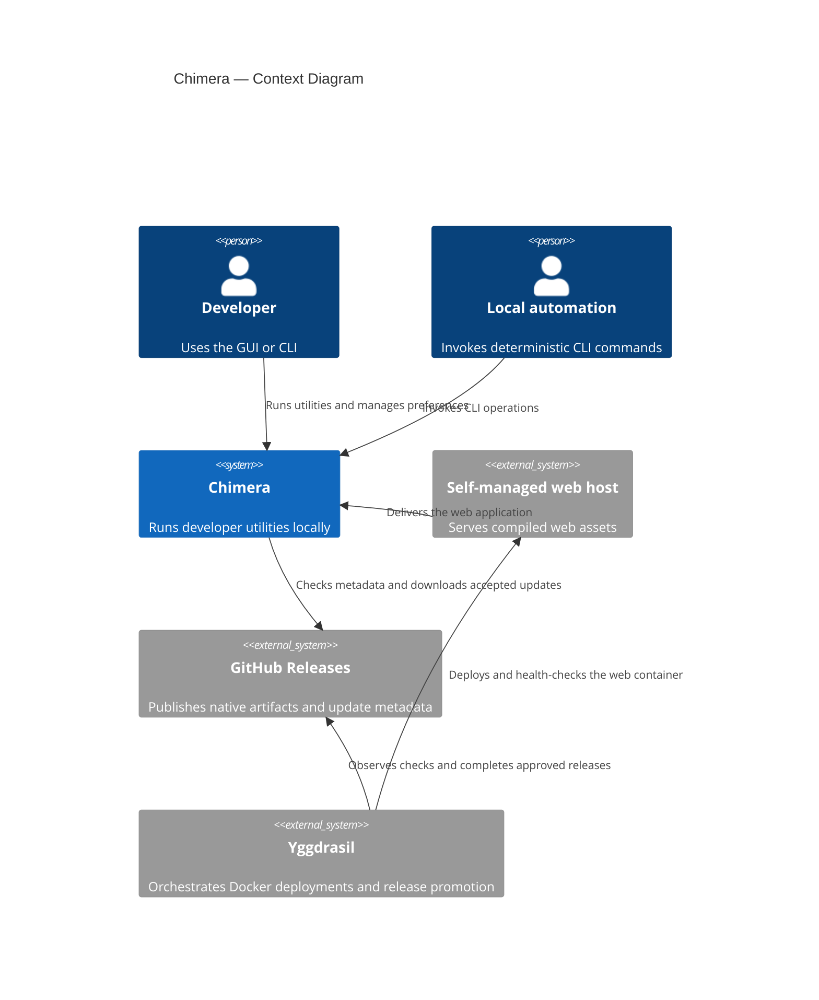
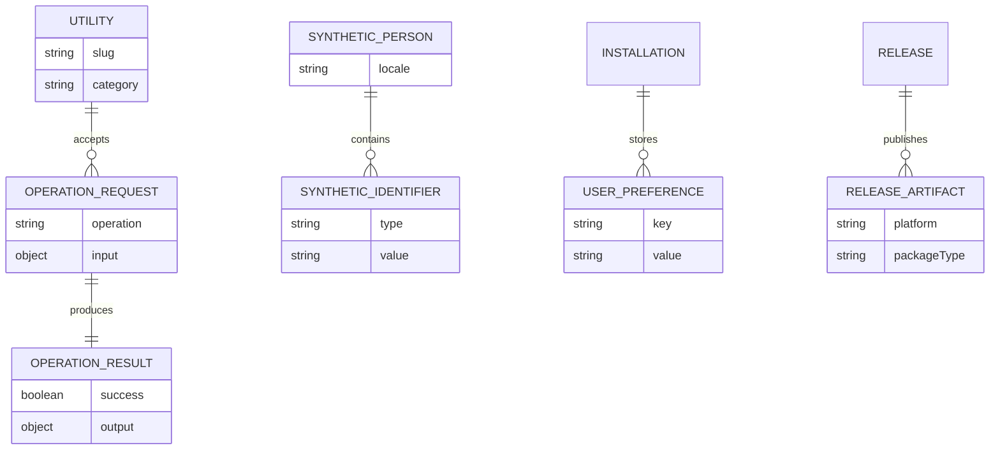

# Vision Document — Chimera

## 1. Introduction

### 1.1 Purpose

This document establishes the product vision for Chimera, a multilingual,
cross-platform collection of developer utilities whose transformations and test
data generation run locally on the user's device.

### 1.2 Scope

Chimera covers schedule and date interpretation, structured-data conversion,
number and text tools, encoders and decoders, formatters, test-data generators,
classical ciphers and alphabets, user preferences, native distribution, and
guided updates. It is delivered through a browser application, Windows and Linux
desktop applications, and a Windows and Linux CLI.

The product excludes cloud synchronization, accounts, authentication, plugins,
mobile applications, collaboration, server-side utility processing, and retained
operation history.

### 1.3 Definitions and Acronyms

| Term | Definition |
| --- | --- |
| **Utility** | A conversion, encoding, decoding, formatting, comparison, analysis, or generation capability exposed by Chimera. |
| **Operation** | One user-visible action performed by a utility, such as encoding text or parsing a cron expression. |
| **GUI** | The shared graphical interface delivered through browsers and desktop applications. |
| **CLI** | The command-line interface used by people and local automation. |
| **Synthetic data** | Generated test data that follows applicable format and checksum rules but is not presented as belonging to a real person or account. |
| **Local processing** | Execution on the user's device without transmitting utility input or output elsewhere. |
| **Portable artifact** | A native application package that can run without an installation workflow. |
| **Installer artifact** | A native application package that installs Chimera and its update integration. |

---

## 2. Problem Statement

Developers repeatedly move among unrelated websites, scripts, and small programs
for common transformations and test-data preparation. This costs time, produces
inconsistent behavior, makes automation awkward, and can disclose sensitive data
to third-party services. Chimera consolidates those jobs behind consistent GUI
and CLI surfaces while keeping utility execution local and offline.

---

## 3. Product Position Statement

| Attribute | Description |
| --- | --- |
| **For** | Developers and local developer automation on supported platforms. |
| **Who** | Need reliable day-to-day transformations and realistic synthetic test data without moving data among unrelated tools. |
| **The Chimera** | Is a cross-platform developer toolbox. |
| **That** | Offers consistent, tested utilities through browser, desktop, and command-line interfaces. |
| **Unlike** | A collection of unrelated online converters, one-off scripts, and platform-specific utilities. |
| **Our product** | Executes utility operations locally, works offline, provides localized interactive interfaces, and shares one implementation across surfaces. |

---

## 4. Stakeholders

| Stakeholder | Role | Primary concern |
| --- | --- | --- |
| Developer | Interactive end user | Correct results, fast feedback, privacy, discoverability, and accessible UX. |
| Automation user | CLI consumer | Stable commands, machine-readable output, deterministic behavior, and meaningful exit codes. |
| Contributor | Human or agent implementing work | Traceable requirements, shared algorithms, repeatable tests, and a gated delivery workflow. |
| Product owner | Scope and release decision-maker | Completion of every approved capability and consistent quality across targets. |
| Yggdrasil/VPS operator | Operator of the deployment manager and self-managed web host | Catalog-driven releases, health visibility, safe rollback, and logs that disclose no utility data. |

---

## 5. High-Level Architecture

The web host and GitHub receive no utility inputs or outputs. Their relationships
are limited to application delivery and updates.

---

## 6. Core Features

| ID | Feature | Description |
| --- | --- | --- |
| F-01 | Schedule and date tools | Parses cron expressions and converts dates, formats, epochs, and time zones. |
| F-02 | Structured-data tools | Converts JSON arrays to tables or CSV, converts JSON to YAML, and formats JSON, SQL, and XML. |
| F-03 | Number and text tools | Converts number bases and provides escaping, comparison, analysis, transformation, and list operations. |
| F-04 | Encoders and decoders | Handles Base64, certificates, GZIP, HTML, JWT, QR codes, and URLs without remote processing. |
| F-05 | Test-data generators | Produces hashes, checksums, text, passwords, identifiers, cards, documents, and locale-consistent people. |
| F-06 | Ciphers and alphabets | Encodes and decodes the approved classical ciphers and representation alphabets. |
| F-07 | Cross-platform interfaces | Exposes shared utility behavior through localized browser, desktop, and CLI surfaces and stores only approved preferences. |
| F-08 | Distribution and updates | Publishes native artifacts and lets installed desktop and CLI applications check for and apply approved updates. |

---

## 7. Domain Model Overview

Operation requests and results are ephemeral. Only the two user preferences are
stored locally; release metadata comes from the artifact host.

---

## 9. Constraints

- The implementation shall use the platform and dependency policy defined in the
  [Technology Stack Document](Technology%20Stack%20Document.md).
- Utility operations shall remain usable offline and shall not transmit inputs or
  outputs off the user's device.
- Browser support is limited to Chromium, Firefox, and Safari; native support is
  limited to Windows and Linux.
- English and Brazilian Portuguese are the only initial interface languages, and
  English is the default.
- The web build runs in Docker on the self-managed Ubuntu VPS behind Traefik and
  is deployed through the owner's Yggdrasil installation.
- Native artifacts and update metadata are distributed through GitHub Releases.
- There are no current compliance, budget, or deadline constraints beyond the
  approved functional, privacy, accessibility, testing, and platform scope.

---

## 10. Success Criteria

- Every approved utility operation is implemented on all applicable interfaces.
- Every functional requirement, business rule, main flow, alternative flow,
  supported target, and localization path has passing automated coverage.
- Utility operations complete without an external service and never transmit
  their input or output.
- The web application passes its functional suite in Chromium, Firefox, and
  Safari.
- Native GUI and CLI suites pass on Windows and Linux.
- Interactive interfaces conform to WCAG 2.2 Level AA criteria applicable to the
  supported surfaces.
- Desktop and CLI releases provide portable and installer artifacts and can
  verify and apply a user-approved update.
- Numeric performance and service-availability thresholds are established and
  enforced by automated checks before the first production release.
